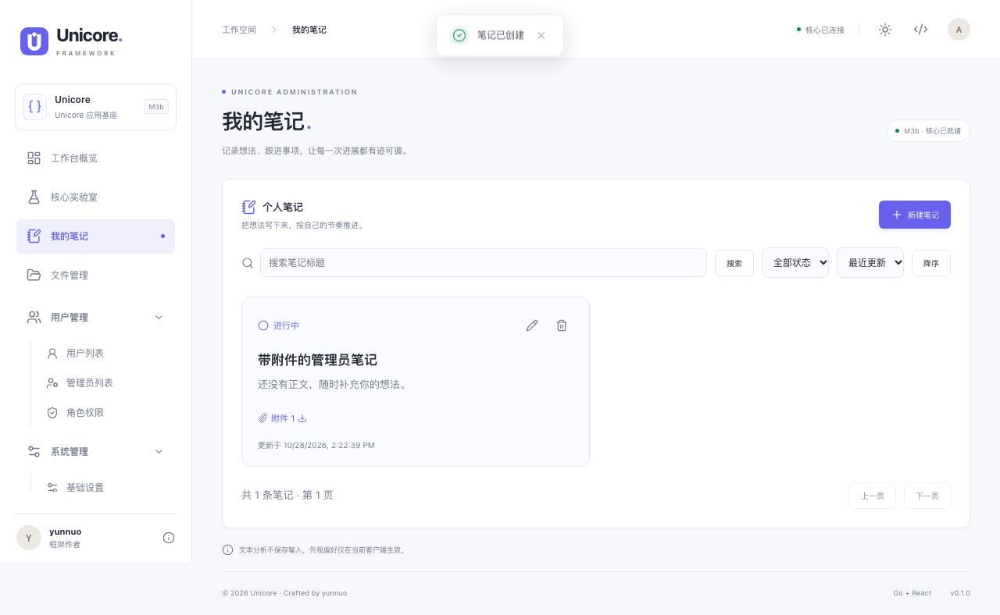

<!-- Author: yunnuo <ymz@ebox.vip> -->
# Unicore

[简体中文](README.md) · **English**


**Build Web, desktop, and command-line applications with Go and React.**

[](https://github.com/yunnuo88520/Unicore/actions/workflows/ci.yml)
[](https://github.com/yunnuo88520/Unicore/actions/workflows/security.yml)
[](LICENSE)

Unicore is a Go + React + TypeScript application framework. Business rules and use cases live in a shared Go Core, with HTTP for Web, Wails for desktop, and Cobra for the command line. Graphical applications share React pages and components.

Installation, accounts and permissions, file storage, notifications, backups, and updates come with the framework. An optional personal-notes demo shows how to connect your own business features.

[Documentation](https://unicore.ebox.vip/en/) · [Quick start](#quick-start) · [Create an application](docs/product/development.md) · [Downloads](https://github.com/yunnuo88520/Unicore/releases) · [Contributing](CONTRIBUTING.md) · [Changelog](CHANGELOG.md)

> Unicore is a 0.x development preview. APIs, internal components, and database schemas may change incompatibly. Read the [support policy](docs/support.md) and the matching release notes before deployment.

## Choose a product form

| Form | Build | Composition profiles |
| --- | --- | --- |
| Platform | Applications with accounts, roles, and an administration workspace | `web-platform` |
| Standalone | Single-user tools delivered as Web and native desktop applications | `web-standalone`, `desktop` |
| CLI | Commands and scripts with no UI or persistent state of their own | `cli` |

Platform provides unified accounts, multiple roles, email verification, OIDC, and server-enforced permissions. Standalone has no platform accounts or administration: Web supports SQLite, PostgreSQL, and MySQL; desktop initializes local SQLite automatically. CLI calls Core directly; its current sample performs stateless text analysis.

## What is included

- **Business development:** layered Go code, module registration, database migrations, and a notes sample with attachments, concurrent editing, and authorization.
- **Shared UI:** a responsive workspace, forms, tables, charts, Chinese and English interfaces, and device appearance preferences.
- **Contracts and integration:** OpenAPI, generated Go/TypeScript DTOs and SDKs, and Cookie/JWT/personal access token authentication.
- **Platform administration:** role grants, menus, departments and posts, announcements, an inbox, email, and Webhook notifications.
- **Operations:** Web tar packages and Docker, offline encrypted backups, signed updates, logs, and runtime monitoring.

Disable the notes demo at build time with `FEATURE_NOTES=false`; see [feature trimming](docs/product/features.md). See [getting started](website/pages/en/getting-started.md) and [support](docs/support.md) for availability and limitations.

## Create your application

Install Go 1.26.11+, Node.js 22.22.2+ (see [package.json](package.json) for other supported versions), pnpm 11.25.0, Git, Make, and ripgrep. Desktop development also requires the [Wails native dependencies](https://wails.io/docs/gettingstarted/installation).

Run this from a clean framework checkout. The destination must be outside the repository and must not already exist:

```sh
git clone https://github.com/yunnuo88520/Unicore.git
cd Unicore
pnpm create:project --directory ../my-app --name 'My App' --slug my-app --module github.com/team/my-app --bundle com.team.myapp --repository https://github.com/team/my-app
cd ../my-app
make install
make dev-server
# Second terminal: make dev-web
```

The creator replaces product names, the Go module, commands, and desktop identifiers, then initializes an independent Git repository with an upstream reference. It does not create a remote repository or push code. Continue with the [development guide](docs/product/development.md), or add note tags in the [first feature tutorial](docs/product/first-feature.md).

## Trim the demo and optional features

Notes is an optional module. After creating your project, build without the demo:

```sh
FEATURE_NOTES=false make build-web
# Also omit in-app updates
FEATURE_NOTES=false FEATURE_UPDATER=false make build-web
```

This omits notes pages, APIs, permissions, navigation, and business implementation. New databases skip notes migrations; existing data and migration history are retained. Development frontend and backend processes must use matching flags. Read [feature trimming](docs/product/features.md) for details.

## Quick start

```sh
git clone https://github.com/yunnuo88520/Unicore.git
cd Unicore
make install
make doctor
make dev-server
```

In a second terminal:

```sh
cd Unicore
make dev-web
```

Open [http://127.0.0.1:5173](http://127.0.0.1:5173) to start the installation wizard. Read the one-time token from `data/bootstrap.token`, select Platform and SQLite, and create your administrator account. Open “My notes” to create and edit notes and upload attachments.

Use a new, dedicated database for a trial. Clearing a nonempty database requires additional confirmation; never use an existing business database for a trial. Follow the [getting started guide](website/pages/en/getting-started.md) for the full walkthrough.



## Install and deploy

To run without editing source, download the package matching your OS and architecture from [Releases](https://github.com/yunnuo88520/Unicore/releases).

| Target | Guide |
| --- | --- |
| Server / self-hosted Web | [Docker, Compose, and tar/systemd](docs/product/deployment.md) |
| macOS, Windows, Linux desktop | [Desktop and CLI installation](docs/product/install-desktop.md) |
| Compile your own build | [Build from source](docs/product/build.md) |
| Upgrade or move an instance | [Updates](docs/product/updates.md) · [Backup and restore](docs/product/backup.md) |

## Development and contributions

```sh
make docs                       # Refresh contracts, themes, migrations, and documentation
make test                       # Generated-file checks, Go tests, and frontend tests
make build-web build-cli        # Build Web and the independent CLI
pnpm --dir website dev          # Read and edit the documentation locally
```

Find usage and development guides in the [documentation index](docs/README.md). Read [CONTRIBUTING](CONTRIBUTING.md) before contributing code, [SUPPORT](SUPPORT.md) for bug reports, and [SECURITY](SECURITY.md) for private vulnerability reports.

## License

[MIT License](LICENSE). Commercial use, modification, and redistribution are permitted with the copyright and license notices retained.
