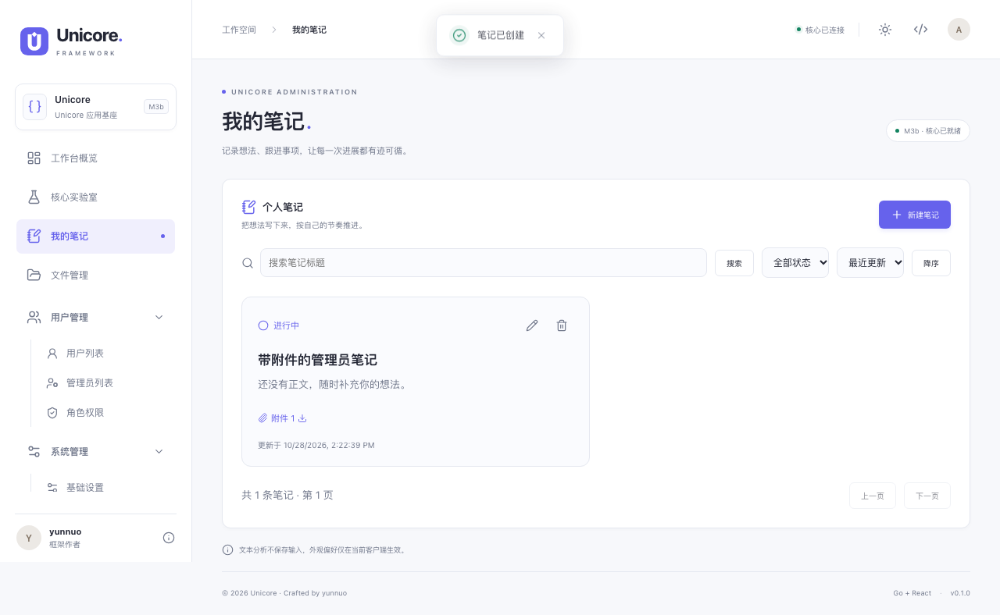

<!-- Author: yunnuo <ymz@ebox.vip> -->
# Unicore


**一份 Go Core，一套 React UI，连接 Web、桌面与 CLI。**

[](https://github.com/yunnuo88520/Unicore/actions/workflows/ci.yml)
[](https://github.com/yunnuo88520/Unicore/actions/workflows/security.yml)
[](LICENSE)

Unicore 是面向 AI 辅助开发的 Go + React 应用框架。共享领域与用例，通过 HTTP、Wails 和 Cobra 分别装配；自带安装、身份、设置、文件存储、业务样板及开发文档，让新项目从可运行、可验证的基座开始。

作者：yunnuo · ymz@ebox.vip · 当前版本：[VERSION](VERSION) · **开发预览**

[快速开始](#快速开始) · [创建自己的应用](#创建自己的应用) · [Wiki](https://github.com/yunnuo88520/Unicore/wiki) · [文档源码](docs/README.md) · [参与贡献](CONTRIBUTING.md) · [支持与反馈](SUPPORT.md) · [变更记录](CHANGELOG.md)

## 选择运行形态

| Profile | 适用场景 | 身份与管理 | 数据库 |
| --- | --- | --- | --- |
| `web-platform` | 在线多用户应用 | 管理端/用户端独立入口与 API，管理员/普通用户物理拆表 | 推荐 MySQL / PostgreSQL，SQLite 可选 |
| `web-standalone` | 自托管的单用户工具 | 无账号、管理端或全局设置页面，仅本地外观 | MySQL / PostgreSQL / SQLite |
| `desktop` | Wails v2 原生桌面 | 无安装页、账号或平台管理模块 | 自动初始化本地 SQLite |
| `cli` | 命令行与脚本集成 | 直接调用共享 Core | 不引入 HTTP、Wails 或数据库 |

平台具备一次性安装、服务端权限、SMTP 六位验证码、OIDC、全局设置、文件元数据与私有签名访问。文件存储默认本地，支持配置 MinIO / S3 / OSS / COS；支持管理员统一文件大小/分片策略、暂停与刷新/重启续传；真实云端验证范围目前为 MinIO 和阿里云 OSS（腾讯云因账号权限保留待验证），详见 [存储手册](docs/03-runbooks/storage.md)。单机与桌面只提供业务和本地外观，品牌在构建时统一配置。

三个有数据库的形态共享个人笔记业务样板，覆盖领域、Repository、迁移、API/原生桥接、并发控制和弹窗表单；平台另外演示本人 file_id 附件，CLI 保持无数据库。其他基座包括 OpenAPI 单一契约、统一主题/图标/消息、生命周期/健康检查、离线加密备份恢复，以及随仓库分发的 AI 文档和 12 个任务 Skills。



预览安装包与校验和见 [GitHub Releases](https://github.com/yunnuo88520/Unicore/releases)，也可从源码构建；尚无公开注册表镜像。已接入可替换渠道的签名 OTA、离线版本日志及平台签名/公证流程；真实开发者凭据和下一版签名发行仍待配置，授权服务保持占位。详见 [系统更新](docs/03-runbooks/updates.md)；能力与验收边界见 [PRD](docs/00-product/PRD.md) 和 [最新验收](docs/04-ai/acceptance-updates.md)。


平台管理端提供可筛选、排序、分页和导出的操作日志，以及独立邮件模板编辑、预览与测试发送；权限、迁移和开发约定见 [管理工具](docs/03-runbooks/admin-tools.md)。

图形入口共用中英文切换与本地主题抽屉，可调整配色、圆角、密度和布局，刷新后保留；与服务器全局配置隔离。扩展入口见 [客户端语言与外观](docs/03-runbooks/client-preferences.md)。

## 快速开始

开发需要 Go 1.26.10+、Node 22+、pnpm 11.25.0、Git、Make 和 ripgrep（`rg`）。pnpm 版本见 `packageManager`；`make doctor` 检查环境。macOS 可用 `brew install ripgrep`，Ubuntu/Debian 可用 `sudo apt-get install ripgrep`。Windows 建议使用 WSL2 开发 Web/CLI；构建 Windows 原生桌面请在 Windows 上安装 Make、Wails 和 WebView2，详见 [Wails 原生依赖](https://wails.io/docs/gettingstarted/installation)。

```sh
git clone https://github.com/yunnuo88520/Unicore.git
cd Unicore
make install
make doctor
make dev-server
# 第二个终端在同一目录执行
make dev-web
```

访问 `http://127.0.0.1:5173`。首次进入 `/install`，从私有目录 `data/bootstrap.token` 读取一次性安装凭据，选择平台或单机。默认 MySQL，PostgreSQL 同为推荐；先创建专用数据库，填写连接参数并测试。快速本机体验可显式选 SQLite。平台管理员由安装页创建，演示可填写 `admin / Admin@123456`，框架不预置账号。

非空库初始化会清空数据，必须备份并精确确认库名；已有 Unicore 安装不能覆盖。安装后保存数据库、私有目录和密钥，重启自动恢复。安装凭据与加密密钥不同；详见 [安装与部署](docs/03-runbooks/deployment.md)。

```sh
# 构建内嵌前端的 Web 二进制，访问 http://127.0.0.1:8080
make build-web
build/bin/server

# CLI 无需安装或启动服务
make dev-cli ARGS='execute --text "Hello Unicore"'

# 原生桌面：先安装当前系统的 Wails 原生依赖
go install github.com/wailsapp/wails/v2/cmd/wails@v2.12.0
make dev-desktop
```

桌面默认数据目录为系统 AppData 下的 `Unicore/desktop`，`APP_DATA_DIR` 可指定隔离目录。Web 默认监听 loopback；无身份的远程单机模式需要外层认证或访问控制。

## 创建自己的应用

在已提交的框架源码中执行，目标目录必须不存在且位于当前仓库之外：

```sh
pnpm create:project --directory ../my-app --name 'My App' --slug my-app --module github.com/team/my-app --bundle com.team.myapp
cd ../my-app
git init
make install
make docs
make doctor
make dev-server
# 第二个终端：make dev-web
```

创建器更换名称、Go module、产品 slug 和桌面 bundle ID，记录上游提交，不复制 Git 历史、实例数据、env 或构建产物。主题入口为 [tokens.json](assets/theme/tokens.json)，品牌轮廓入口为 [identity.json](assets/brand/identity.json)，构建统一生成 Logo、ICO、原生图标与邮件配色。派生后还需调整自己的仓库链接、反馈渠道和安全策略，见 [派生与上游更新](docs/03-runbooks/framework-upgrade.md)。

需要隔离开发依赖时，按 [开发依赖配置](deploy/docker/compose.dev.yaml) 设置临时凭据，再执行 `make dev-deps-up SERVICES='postgres mysql mail'`；MinIO 可另启或连接已有服务。`make dev-deps-down` 停止并默认保留卷。不要使用生产库或真实 SMTP 做自动化测试。

## 验证与构建

```sh
make docs                        # 契约/设计/AI 上下文生成
make test                        # 漂移、边界、vet/race、TS、前端测试
pnpm exec playwright install chromium
make build-web && make test-e2e  # 独立实例，PC / 375px 页面回归
make package RELEASE_TARGETS=linux/amd64 RELEASE_PROFILES=web-platform
make release                     # 完整 Web / CLI tar 矩阵
make docker-build                # 本机架构镜像，不执行 push
make compose-up                  # 构建并启动 127.0.0.1:8088
make build-desktop               # 在目标系统原生构建
make build-ops                   # 独立加密备份/恢复工具
```

应用版本只维护 [VERSION](VERSION)；`make version NEW_VERSION=x.y.z` 同步投影和 Changelog。tar 输出到 `build/releases/`，带 manifest/checksums；Web 包含运维工具，镜像标签读取相同版本。宝塔/Nginx、Docker/Compose、版本准备和恢复步骤见 [发版手册](docs/03-runbooks/release.md)、[部署手册](docs/03-runbooks/deployment.md) 与 [备份手册](docs/03-runbooks/backup.md)。

最新基线已通过三数据库测试、页面回归、四种部署场景与三系统原生构建 CI；macOS arm64 有真实窗口交互验证，Windows/Linux 窗口交互仍待实测。结果与未测范围见 [验收报告](docs/04-ai/acceptance-updates.md)，实时状态以当前提交的 Actions 为准。

## 文档与协作

| 需要做什么 | 入口 |
| --- | --- |
| 了解范围和架构 | [PRD](docs/00-product/PRD.md)、[架构](docs/01-architecture/architecture.md)、[基础能力](docs/04-ai/foundation-audit.md) |
| 扩展业务、API、页面或设置 | [笔记样板](docs/03-runbooks/business-example.md)、[AI 工作流](docs/04-ai/development.md)、[上下文地图](docs/04-ai/context.gen.md) |
| 调整主题、品牌或文件存储 | [设计系统](docs/02-standards/design-system.md)、[存储手册](docs/03-runbooks/storage.md) |
| 查看 API 与运行配置 | [契约约定](docs/02-standards/api-contract.md)、[运行基座](docs/02-standards/runtime.md)；设置 `APP_API_DOCS=true` 开启 `/docs/api` |
| 提交改动或反馈问题 | [贡献指南](CONTRIBUTING.md)、[支持](SUPPORT.md)、[安全报告](SECURITY.md)、[行为准则](CODE_OF_CONDUCT.md) |
| 维护 GitHub 开源仓库 | [维护手册](docs/03-runbooks/open-source.md) |
| 更新 Wiki | [同步说明](docs/wiki/README.md)；`make wiki` 生成，明确发布时 `make wiki-publish` |

仓库采用 [MIT License](LICENSE)，允许使用、修改和再分发，保留版权与许可证。完整导航见 [docs/README.md](docs/README.md)。

后端开发遵循[统一实体与分层规范](docs/02-standards/backend.md)，平台公告提供[完整双端业务样板](docs/03-runbooks/announcements.md)，支持管理员发布、定时展示与用户工作台读取。邮件默认内容保持中文，界面支持中英文切换。
