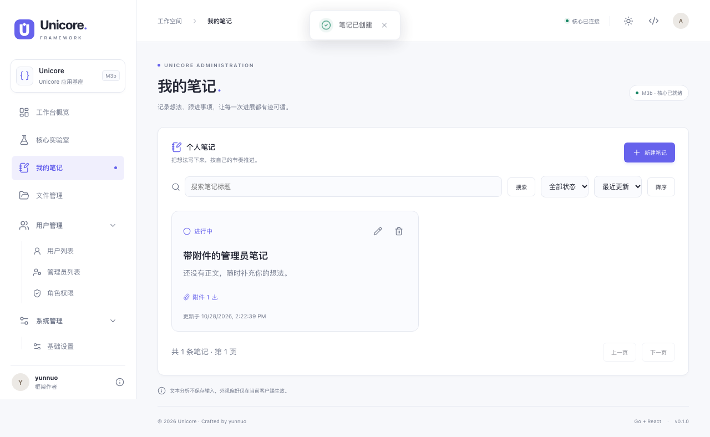

<!-- Author: yunnuo <ymz@ebox.vip> -->
# Unicore

**简体中文** · [English](README.en.md)


**一份 Go Core，一套 React UI，连接 Web、桌面与 CLI。**

[](https://github.com/yunnuo88520/Unicore/actions/workflows/ci.yml)
[](https://github.com/yunnuo88520/Unicore/actions/workflows/security.yml)
[](LICENSE)

Unicore 是供 Go + React 开发者创建和改造自己产品的应用基座。共享领域与用例，通过 HTTP、Wails 和 Cobra 分别装配；自带安装、身份、设置、文件存储、业务样板及开发文档，让新项目从可运行、可验证的基座开始。

作者：yunnuo · ymz@ebox.vip · 当前版本：[VERSION](VERSION) · **开发预览**

[文档站](https://unicore.ebox.vip) · [快速开始](#快速开始) · [创建自己的应用](#创建自己的应用) · [Wiki](https://github.com/yunnuo88520/Unicore/wiki) · [文档源码](docs/README.md) · [参与贡献](CONTRIBUTING.md) · [支持与反馈](SUPPORT.md) · [变更记录](CHANGELOG.md)

运行形态、功能边界与待验证范围见 [支持范围与已知限制](docs/support.md)。使用与部署从 [指南](docs/product/index.md) 开始；开发任务按需查阅规范和 Skill。

## 选择运行形态

| Profile | 适用场景 | 身份与管理 | 数据库 |
| --- | --- | --- | --- |
| `web-platform` | 在线多用户应用 | 业务/管理工作台独立入口与 API，统一账号支持多个角色 | 推荐 MySQL / PostgreSQL，SQLite 可选 |
| `web-standalone` | 自托管的单用户工具 | 无账号、管理端或全局设置页面，仅本地外观 | MySQL / PostgreSQL / SQLite |
| `desktop` | Wails v2 原生桌面 | 无安装页、账号或平台管理模块 | 自动初始化本地 SQLite |
| `cli` | 命令行与脚本集成 | 直接调用共享 Core | 不引入 HTTP、Wails 或数据库 |

平台具备一次性安装、服务端权限、SMTP 六位验证码、OIDC、全局设置、文件元数据与私有签名访问。文件存储默认本地，支持配置 MinIO / S3 / OSS / COS；支持管理员统一文件大小/分片策略、暂停与刷新/重启续传；真实云端验证范围目前为 MinIO 和阿里云 OSS（腾讯云因账号权限保留待验证），详见 [存储手册](docs/03-runbooks/storage.md)。单机与桌面只提供业务和本地外观，品牌在构建时统一配置。

Platform 与 Standalone 的两个载体共享个人笔记业务样板，覆盖领域、Repository、迁移、API/原生桥接、并发控制和弹窗表单；各载体均支持本人 file_id 附件上传与下载，CLI 保持无数据库。其他基座包括 OpenAPI 单一契约、统一主题/图标/消息、生命周期/健康检查、离线加密备份恢复，以及随仓库分发的 AI 文档和 14 个任务 Skills。



macOS 下载 DMG 并拖到 Applications；Windows 下载 EXE 直接运行；Linux 桌面使用 tar。Web tar 解压后支持 `./unicore help`、`./unicore config generate` 和 `./unicore --config config.yaml`，首次安装继续访问 `/install`。Linux 可用 `./unicore service install` 安装守护服务，再用 `unicore manage` 打开管理菜单；启停、密码恢复及后台路径等见 [管理命令](docs/product/configuration.md#web-管理命令)。OTA 仍使用完整 tar 发行目录。

预览安装包与校验和见 [GitHub Releases](https://github.com/yunnuo88520/Unicore/releases)，也可从源码构建；尚无公开注册表镜像。已接入可替换渠道的签名 OTA 与离线版本日志；公开版本是否包含签名更新清单，以对应 Release 资产与验证结果为准。应用层发布者签名必须保留，默认直接分发，不要求官方商店上架、付费 OS 签名或公证；仓库和派生项目均默认允许无 OS 证书的包，OTA 仍须发布者验签。授权服务保持占位。详见 [系统更新](docs/03-runbooks/updates.md)与 [支持范围](docs/support.md)。


平台管理端提供可筛选、排序、分页和导出的操作日志，以及独立邮件模板编辑、预览与测试发送；权限、迁移和开发约定见 [管理工具](docs/03-runbooks/admin-tools.md)。

图形入口共用中英文切换与本地主题抽屉，可调整配色、圆角、密度和布局，刷新后保留；与服务器全局配置隔离。扩展入口见 [客户端语言与外观](docs/03-runbooks/client-preferences.md)。

## 推荐阅读路线

先 [创建自己的应用](docs/product/development.md)，用 SQLite 完成 [第一次体验](docs/product/index.md#第一次体验推荐-sqlite)，再跟随 [第一个功能教程](docs/product/first-feature.md)。CLI 目前只演示无状态文本分析，不含笔记或持久化。框架更新通过源码三方合并完成，没有隔离全部定制的稳定插件接口。

## 快速开始

开发需要 Go 1.26.11+、Node 22.22.2+（22 系列为 CI 基线）、pnpm 11.25.0、Git、Make 和 ripgrep（`rg`）。其他 Node 系列的兼容范围见 `package.json` 的 `engines`，pnpm 版本见 `packageManager`；`make doctor` 检查环境。macOS 可用 `brew install ripgrep`，Ubuntu/Debian 可用 `sudo apt-get install ripgrep`。Windows 建议使用 WSL2 开发 Web/CLI；构建 Windows 原生桌面请在 Windows 上安装 Make、Wails 和 WebView2，详见 [Wails 原生依赖](https://wails.io/docs/gettingstarted/installation)。

```sh
git clone https://github.com/yunnuo88520/Unicore.git
cd Unicore
make install
make doctor
make dev-server
# 第二个终端在同一目录执行
make dev-web
```

访问 `http://127.0.0.1:5173`。首次进入 `/install`，从私有目录 `data/bootstrap.token` 读取一次性安装凭据，选择平台或单机。默认 MySQL，PostgreSQL 同为推荐；先创建专用数据库，填写连接参数并测试。快速本机体验可显式选 SQLite。平台管理员由安装页创建，请设置自己的强密码；框架不预置账号。

非空库初始化会清空数据，必须备份并精确确认库名；已有 Unicore 安装不能覆盖。安装后保存数据库、私有目录和密钥，重启自动恢复。安装凭据与加密密钥不同；详见 [安装与部署](docs/product/deployment.md)。

Web 服务器请从 [从零部署指南](docs/product/deployment.md) 开始：环境和数据库、Docker/Compose、tar/systemd、HTTPS、安装向导和更新排查；参数与配置表见 [配置说明](docs/product/configuration.md)。

```sh
# 构建内嵌前端的 Web 二进制，访问 http://127.0.0.1:3000
make build-web
build/bin/server

# CLI 无需安装或启动服务
make dev-cli ARGS='execute --text "Hello Unicore"'

# 原生桌面：先安装当前系统的 Wails 原生依赖
go install "github.com/wailsapp/wails/v2/cmd/wails@$(go list -m -f '{{.Version}}' github.com/wailsapp/wails/v2)"
make dev-desktop
```

桌面默认数据目录为系统 AppData 下的 `Unicore/desktop`，`APP_DATA_DIR` 可指定隔离目录。Web 默认监听 loopback；无身份的远程单机模式需要外层认证或访问控制。

## 创建自己的应用

在已提交的框架源码中执行，目标目录必须不存在且位于当前仓库之外：

```sh
pnpm create:project --directory ../my-app --name 'My App' --slug my-app --module github.com/team/my-app --bundle com.team.myapp --repository https://github.com/team/my-app
cd ../my-app
make install
make docs
make doctor
make dev-server
# 第二个终端：make dev-web
```

源码采用 MIT，可商用、修改和再分发，保留许可证、版权声明与原作者信息。创建器完成独立仓库的 main 初始提交，更换名称、Go module、CLI/运维命令和桌面标识；可选 --repository 同时配置自己的 origin、界面文档与社区反馈链接，只读 framework 远端保留上游来源，不创建远程仓库或自动推送。产品身份入口为 product.identity.json，主题入口为 [tokens.json](assets/theme/tokens.json)，图形入口为 [identity.json](assets/brand/identity.json)。域名/TLS 属自己的运行部署配置；安装页使用实际访问地址。仍需审阅支持联系人、安全策略与更新签名，见 [派生与上游更新](docs/product/framework-upgrade.md)。

需要隔离开发依赖时，按 [开发依赖配置](deploy/docker/compose.dev.yaml) 设置临时凭据，再执行 `make dev-deps-up SERVICES='postgres mysql mail'`；MinIO 可另启或连接已有服务。`make dev-deps-down` 停止并默认保留卷。不要使用生产库或真实 SMTP 做自动化测试。

## 验证与构建

```sh
make docs                        # 契约/设计/AI 上下文生成
make test                        # 漂移、边界、vet/race、TS、前端测试
pnpm exec playwright install chromium
make build-web && make test-e2e  # 独立实例，PC / 375px 页面回归
make package RELEASE_TARGETS=linux/amd64 RELEASE_PROFILES=web-platform
make release                     # 完整 Web / CLI tar 矩阵
make docker-build                # 本机架构镜像，不执行 push
make compose-up                  # 构建并启动 127.0.0.1:3000
make build-desktop               # 在目标系统原生构建
make build-ops                   # 独立加密备份/恢复工具
```

应用版本只维护 [VERSION](VERSION)；`make version NEW_VERSION=x.y.z` 同步投影和中英文 Changelog；`pnpm check:release-notes` 检查双语入口与说明。tar 输出到 `build/releases/`，带 manifest/checksums；Web 包含运维工具，镜像标签读取相同版本。宝塔/Nginx、Docker/Compose、版本准备和恢复步骤见 [发版手册](docs/03-runbooks/release.md)、[部署手册](docs/03-runbooks/deployment.md) 与 [备份手册](docs/03-runbooks/backup.md)。

质量、依赖安全和 Profile 构建结果查看当前提交的 CI。原生构建/helper 测试不等于完整 GUI 更新与失败恢复；发布前按目标系统和部署环境验证，不能用历史结果代替当前检查。

## 文档与协作

文档站使用 VitePress，正式域名配置为 [unicore.ebox.vip](https://unicore.ebox.vip)；域名与托管完成配置后生效。它复用仓库 Markdown，提供导航、本地搜索和中英文入口，详细手册目前主要为中文。开发与部署见 [文档站手册](docs/03-runbooks/documentation-site.md)。

```sh
pnpm --dir website dev       # 本地文档站，编辑原始 Markdown
pnpm --dir website build     # 静态产物：build/docs-site-dist/
pnpm --dir website preview   # 预览静态站
```

| 需要做什么 | 入口 |
| --- | --- |
| 了解范围和架构 | [支持范围](docs/support.md)、[架构](docs/01-architecture/architecture.md) |
| 扩展业务、API、页面或设置 | [笔记样板](docs/03-runbooks/business-example.md)、[AI 工作流](docs/04-ai/development.md)、[上下文地图](docs/04-ai/context.gen.md) |
| 调整主题、品牌或文件存储 | [设计系统](docs/02-standards/design-system.md)、[存储手册](docs/03-runbooks/storage.md) |
| 查看 API 与运行配置 | [契约约定](docs/02-standards/api-contract.md)、[运行基座](docs/02-standards/runtime.md)；设置 `APP_API_DOCS=true` 开启 `/docs/api` |
| 提交改动或反馈问题 | [贡献指南](CONTRIBUTING.md)、[支持](SUPPORT.md)、[安全报告](SECURITY.md)、[行为准则](CODE_OF_CONDUCT.md) |
| 维护 GitHub 开源仓库 | [维护手册](docs/03-runbooks/open-source.md) |
| 更新 Wiki | [同步说明](docs/wiki/README.md)；`make wiki` 生成，明确发布时 `make wiki-publish` |

仓库采用 [MIT License](LICENSE)，允许使用、修改和再分发，保留版权与许可证。完整导航见 [docs/README.md](docs/README.md)。

后端开发遵循[统一实体与分层规范](docs/02-standards/backend.md)，平台公告提供[完整双端业务样板](docs/03-runbooks/announcements.md)，支持管理员发布、定时展示与用户工作台读取。邮件默认内容保持中文，界面支持中英文切换。

框架表固定使用 unicore_ 前缀，不随派生产品名变化；业务自建表可自行命名。Web 完成安装后生成 install.lock，只有服务器管理员停服删锁并重启才能凭新凭据进入重装；重装原库须确认清空且拒绝其他实例数据。
