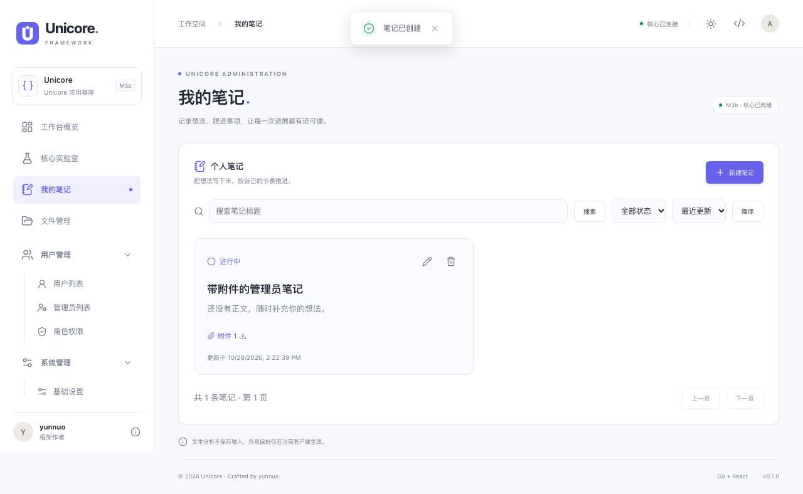

<!-- Author: yunnuo <ymz@ebox.vip> -->
# Unicore

**简体中文** · [English](README.en.md)


**用 Go 和 React 构建 Web、桌面与命令行应用。**

[](https://github.com/yunnuo88520/Unicore/actions/workflows/ci.yml)
[](https://github.com/yunnuo88520/Unicore/actions/workflows/security.yml)
[](LICENSE)

Unicore 是一个 Go + React + TypeScript 应用框架。业务规则与用例在 Go Core 中共享，Web 使用 HTTP，桌面使用 Wails，命令行使用 Cobra；图形界面复用同一套 React 页面和组件。

框架提供安装向导、账号与权限、文件存储、通知、备份和更新等基础能力，附带可裁剪的个人笔记 demo，用于展示业务接入方式。

[文档](https://unicore.ebox.vip) · [快速开始](#快速开始) · [创建应用](docs/product/development.md) · [下载安装包](https://github.com/yunnuo88520/Unicore/releases) · [参与贡献](CONTRIBUTING.md) · [变更记录](CHANGELOG.md)

> 当前为 0.x 开发预览，API、内部组件和数据库可能发生不兼容变化。部署前请阅读 [支持范围](docs/support.md) 和对应版本的发行说明。

## 选择产品形态

| 形态 | 适合构建 | 装配 profile |
| --- | --- | --- |
| Platform | 有账号、角色和管理工作台的多用户应用 | `web-platform` |
| Standalone | 单用户工具，提供 Web 与原生桌面两个载体 | `web-standalone`、`desktop` |
| CLI | 无界面、无自身持久化的命令行与脚本工具 | `cli` |

Platform 支持统一账号、多角色、邮箱验证、OIDC 和服务端权限控制。Standalone 不提供平台账号或管理后台：Web 可选择 SQLite、PostgreSQL 或 MySQL；桌面自动初始化本地 SQLite。CLI 直接调用 Core，当前样板是无状态文本分析。

## 框架提供什么

- **业务开发**：分层 Go 代码、模块注册、数据库迁移，以及包含附件、并发编辑和权限校验的可选笔记 demo。
- **共享界面**：响应式工作区、表单、表格、图表、中英文界面与设备级外观设置。
- **契约与集成**：OpenAPI 契约、生成的 Go/TypeScript DTO 与 SDK、Cookie/JWT/个人访问令牌认证。
- **平台管理**：角色授权、菜单、部门与岗位、公告、站内信、邮件和 Webhook 通知。
- **部署运维**：Web tar 包与 Docker、离线加密备份、签名更新、日志及运行监控。

笔记 demo 可用 `FEATURE_NOTES=false` 在构建时关闭，详见 [功能裁剪](docs/product/features.md)。各形态的能力和限制见 [快速开始](docs/product/index.md) 与 [支持范围](docs/support.md)。

## 创建自己的应用

准备 Go 1.26.11+、Node.js 22.22.2+（其他支持版本见 [package.json](package.json)）、pnpm 11.25.0、Git、Make 和 ripgrep。桌面开发另需 [Wails 原生依赖](https://wails.io/docs/gettingstarted/installation)；macOS 的原生 DMG 回归测试还需 Python 3（仅使用标准库）。

在干净的框架源码仓库中执行，目标目录应位于仓库之外且尚不存在：

```sh
git clone https://github.com/yunnuo88520/Unicore.git
cd Unicore
pnpm create:project --directory ../my-app --name 'My App' --slug my-app --module github.com/team/my-app --bundle com.team.myapp --repository https://github.com/team/my-app
cd ../my-app
make install
make dev-server
# 第二个终端：make dev-web
```

创建器替换产品名称、Go module、命令和桌面标识，初始化独立 Git 仓库并保留框架来源。它不会创建远程仓库或推送代码。接下来阅读 [开发指南](docs/product/development.md)，或跟随 [第一个功能教程](docs/product/first-feature.md) 给笔记增加标签。

## 裁剪示例与可选功能

笔记不是框架必需模块。创建项目后，可直接构建不含笔记 demo 的产品：

```sh
FEATURE_NOTES=false make build-web
# 同时关闭应用内更新
FEATURE_NOTES=false FEATURE_UPDATER=false make build-web
```

关闭后不装配笔记页面、API、权限、导航或业务实现，新库不执行笔记迁移。开发模式须给前后端设置相同开关；已有实例保留数据和迁移历史。Platform 既有菜单配置与授权也会保留，其他菜单仍可正常保存，重新启用后沿用原配置。完整说明见 [功能裁剪](docs/product/features.md)。

## 快速开始

```sh
git clone https://github.com/yunnuo88520/Unicore.git
cd Unicore
make install
make doctor
make dev-server
```

在第二个终端中运行：

```sh
cd Unicore
make dev-web
```

打开 [http://127.0.0.1:5173](http://127.0.0.1:5173)，进入安装向导。一次性安装凭据保存在 `data/bootstrap.token`；选择 Platform 和 SQLite，并创建自己的管理员账号。安装后打开“我的笔记”，即可体验创建、编辑和附件上传。

试用请使用新建的专用数据库。非空库需要额外确认清空，不能将已有业务库用于试装。完整步骤见 [快速开始](docs/product/index.md)。



## 安装与部署

不修改源码时，可直接使用 [Releases](https://github.com/yunnuo88520/Unicore/releases) 中对应系统和架构的安装包。

| 目标 | 操作指南 |
| --- | --- |
| 服务器 / 自托管 Web | [Docker、Compose 与 tar/systemd 部署](docs/product/deployment.md) |
| macOS、Windows、Linux 桌面 | [桌面与 CLI 安装](docs/product/install-desktop.md) |
| 自行编译 | [源码构建](docs/product/build.md) |
| 升级或迁移实例 | [更新](docs/product/updates.md) · [备份恢复](docs/product/backup.md) |

## 开发与贡献

```sh
make docs                       # 更新契约、主题、迁移和文档投影
make test                       # 生成检查、Go 和前端测试
make build-web build-cli        # 构建 Web 与独立 CLI
pnpm --dir website dev          # 本地阅读和编辑文档站
```

[文档目录](docs/README.md) 提供使用与开发入口。贡献代码前请阅读 [CONTRIBUTING](CONTRIBUTING.md)；问题反馈见 [SUPPORT](SUPPORT.md)，安全问题通过 [私密渠道](SECURITY.md) 报告。

## 许可

[MIT License](LICENSE)，允许商用、修改和再分发，需保留版权与许可声明。
