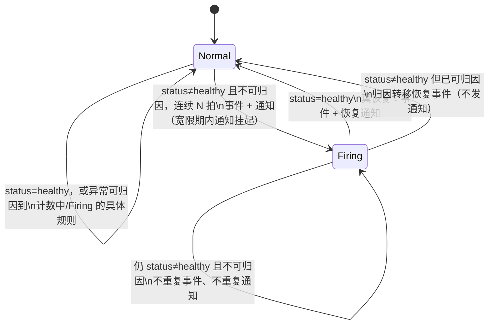
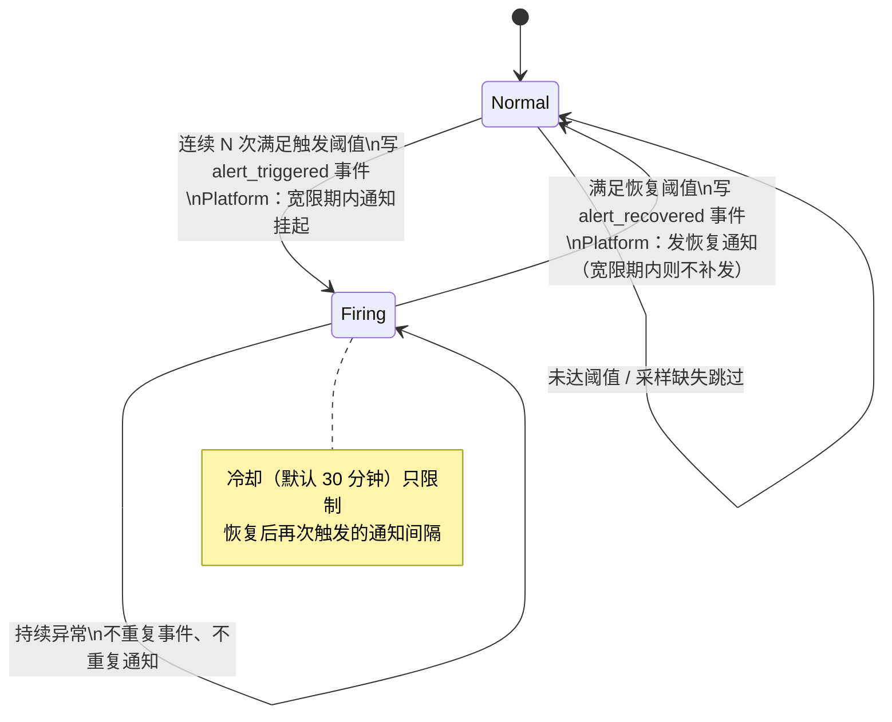

<!-- Author: yunnuo <ymz@ebox.vip> -->
# Runtime Monitor（运行监控中心）设计草案

> 状态：**P0（T1+T2）已验收；P1（T3）已实现**：服务健康完整化（连接池/存储逐位置探活/任务运行记录关联）、运行事件环形缓冲 + 事件页（两形态），宿主机深度指标（cgroup 限额视图/温度采样/网络速率服务端化）；导航存量升级按 per-node 种子合并（monitor-events 自动补入）。T4 告警已按方案二**实现**（§9.3）：Platform 完整告警 + Standalone 本地告警，两形态同一检测引擎；告警通知已接入 notifycontent 事件矩阵（§8：`alert_triggered`/`alert_recovered` 独立模板与路由，全部事件通知统一受「启用系统通知」总开关控制，无隐式绕过）；实现与设计的偏差仅有两处并已记录——任务规则评估排除禁用任务（快照字段保持全量语义）、告警通知 detail 为结构化 KV（含规则/值/阈值/视角/实例标识）。形态决策 D18–D22 已全部裁决并落地（D19 sameOrigin 只读、D21 事件为 P1 进程内缓冲、D22 告警为 P2 平台复用通知渠道；D20 原裁 P0 仅进程内，2026-11-11 维护者在验收时将宿主机只读硬件视图上提至 P0，见 pending-decisions.md D20 追记）。实现依据本文件第 4/5/8/9 节；能力矩阵与功能清单已按第 10 节增量更新（P0 范围标「已实现」，P1/P2 标「规划」）。本文件不进入 `framework.manifest.json` sources；全部监控快照为只读拉取式，无新表、无后台采集。遵守 [产品形态与能力边界规范](product-forms.md)：Platform / Standalone（Web + GUI 两等效载体）/ CLI 三种产品形态，四个装配 profile 不是形态。

## 1. 现有监控能力审计（源码证据）

分类：**A 已实现且可复用**｜**B 已实现需扩展**｜**C 仅设计/文档**｜**D 尚未实现**｜**E 待维护者决策**。

| 能力 | 分类 | 证据与说明 |
| --- | --- | --- |
| 版本/构建/profile/deployment 元数据 | A | `internal/buildinfo`、`internal/runtime/profile.go` `Metadata()`（bootstrap 已下发 version/commit/buildTime/stage/deployment/capabilities） |
| 健康检查（live/ready + DB Ping + 就绪超时） | A | `internal/adapter/http/policy.go`（`/api/v1/health/live`、`/health/ready`，503 NOT_READY）；[运行基座](../02-standards/runtime.md) §健康检查 |
| Prometheus 指标：HTTP 请求（active/total/duration 直方图，路由模板标签） | A | `internal/observability/metrics.go`（私有 Registry + promhttp）；独立 loopback 监听，`--monitor-listen` 可选开启（`cmd/server/main.go`） |
| Prometheus 指标：数据库连接池（open/in_use/idle/wait_total/wait_seconds，源自 `sql.DBStats`） | A | `internal/observability/metrics.go` `Handler(database func() *sql.DB)`；runtime.md 明确「DB 未装配时指标为零，不能据此判断就绪」 |
| Prometheus 指标：Go Runtime（goroutine/GC/内存）与进程（OS 能力相关） | A | 同上，标准 collectors；runtime.md：「process 指标是否可用取决于目标 OS 的采集能力，不声称所有系统指标一致」 |
| 数据库探活（Ping）与迁移校验 | A | `internal/adapter/storage/{sqlite,webdb}/open.go`；健康 ready 即 Ping |
| 平台定时任务：状态列（last_run_at/last_status/last_error/run_count/next_run_at）+ 运行记录 | A | `internal/scheduler/scheduler.go` `record()`：内置任务只更新 `unicore_scheduled_jobs.last_*`；**自定义任务**另写 `unicore_task_runs`（每任务上限 50 条，duration_ms/status/error，错误码 TASK_PANIC/TASK_FAILED/TASK_CANCELED/TASK_TIMEOUT）；API `GET /admin/tasks/{name}/runs`（tasks:read，platform-only） |
| 任务管理页面（启停/触发/自建任务） | A | `internal/adapter/http/tasks.go` + 定时任务页；Runtime Monitor **不得**重复其管理操作 |
| 操作审计（写入/查询/导出/流式跟踪） | A | `internal/adapter/storage/sqlstore/audit.go`、`internal/adapter/http/logs.go`、`logstream.go`；platform 查询面（形态规范能力矩阵「审计」行） |
| 应用日志（文件落盘/轮转/保留清理） | A | `internal/logging` sink + sweep；语义见 runtime.md（不含原始 URL/query/凭据） |
| 存储位置健康探活 | B | `POST /admin/storage/test`（storage:write）已实现连通性测试；监控需要**只读、轻量、可批量**的探活复用——需扩展出非管理写语义的内部探测 |
| 离线诊断（status/doctor/database check） | A | `internal/webmanage/instance.go`；属 Web 包实例运维面，不是形态能力，不在本功能范围 |
| 系统更新版本历史 | A | `assets/updates/history.gen.json` + 系统更新页；概览页「当前版本」与它同源（buildinfo），历史仍归更新页 |
| 实时推送通道（进程内 SSE hub） | A | `internal/realtime/hub.go`（platform 装配）；P2 告警推送可复用其广播，注意单实例语义 |
| 通知渠道（邮件/企业微信/签名 Webhook，12 事件） | A | `internal/notifycontent`、`internal/mailer`；platform-only——P2 告警若接入必须遵守该边界 |
| OpenTelemetry / tracing | C | runtime.md：「默认不启用 tracing，OpenTelemetry 与外部日志/告警平台后续按实际部署接入」——仅有文档方向，无实现 |
| 应用内监控快照 API / 监控页面 / 仪表盘运行摘要 / 运行事件流 / 告警 | D | 设计时全仓库无对应实现（现已由本文落地，见状态行）；本文第 6–9 节为设计依据 |
| 宿主机与容器指标口径 | E | P0 已含宿主机只读采样（gopsutil：CPU/内存/磁盘/负载/网络累计）；容器内为内核 `/proc` 视角并在页面披露，精确 cgroup 口径仍属 P1，见 [D20](pending-decisions.md) |
| Standalone 本地监控 API 暴露强度 | E | updates 先例 loopback-only、settings 先例 sameOrigin，二选一见 [D19](pending-decisions.md) |

**结论**：监控的「原料」几乎全部已存在（指标、健康、任务记录、审计、日志、版本），真正缺的是：①把原料聚合为**面向人的运行快照**；②**页面与仪表盘呈现**；③**非平台形态的本地暴露面**（HTTP local + Wails 桥）；④运行事件流与告警（设计时完全没有，现已分阶段落地）。

## 2. 产品定位

Runtime Monitor 是**面向单个 Unicore 实例**的运行状态查看、资源监控、服务健康诊断与异常观察能力。

**是**：

- 实例自观测：状态、版本、时长、资源、服务健康、近期异常。
- Platform 超管的运维工具 + Standalone 单机用户的本机状态中心，产品语义等效。
- 外部监控体系（Prometheus 等）的**补充**：让不搭外部栈的部署开箱可用。

**不是**（防止范围蔓延）：

- 不是 Prometheus/Grafana 替代品：不做长期指标存储、多维查询、外部抓取目标管理。
- 不是基础设施运维平台：不监控宿主机上其他进程/服务，不做多主机。
- 不是多实例集中监控：realtime/调度器均为单实例语义（`internal/realtime/hub.go`），本功能不跨实例聚合。
- 不是普通用户业务统计：不出现业务数据指标（现有管理员仪表盘的成员/活跃统计归管理后台，互不重复）。
- 不是定时任务第二管理页：只**读取**任务健康状态与最近失败，启停/编辑/触发仍在现有定时任务页。

## 3. 三种产品形态的支持边界

| 形态 | 边界 |
| --- | --- |
| Platform | 仅 super_admin 可访问（服务端 superAdmin 保留集硬校验，见 D18）；普通管理员与普通用户不可访问且不呈现；详细页面位于管理员域「运行监控」目录；超管仪表盘可展示摘要；普通用户仪表盘零实例指标 |
| Standalone | Web 与 GUI 两载体**产品等效**：同一快照模型、同一页面结构（单页 + 单层 Tabs）、同一仪表盘摘要；本地使用者免登录查看；不引入任何平台身份/权限；载体不适用的指标显示「不适用」而非虚假数据（如桌面无 HTTP 服务指标）；底层采集允许不同（web 走 HTTP local API，desktop 走 Wails 桥） |
| CLI | 本期不建设：无菜单/仪表盘/常驻采集器/历史存储，不新增 HTTP/Wails/SQL 依赖。Web 包实例运维命令（`doctor`/`status`）已提供离线诊断，属实例运维面而非 CLI 形态，维持现状 |

### 3.1 与现有代码/规范的冲突与适配（明确列出，不默默改边界）

1. **standalone 导航过滤规则**：`packages/web-ui/src/navigation.ts` 对非平台形态剔除 system 组页面（仅保留 site/edition）。运行监控页若挂 system 组将无法出现在单机导航。**适配**：监控路由采用 files 同款模式——无 group + `platformAdminOnly` 集合 + `local: true` + `permission: monitor:read`，不改过滤规则本身。
2. **D13 裁决的导航耦合**：单机「外观设置」页（site）已裁决移除（D13，代码任务未执行）。运行监控页将进入单机业务区导航；建议 D13 移除任务先行或同批执行，避免导航两次变动。
3. **Prometheus 唯一语义源**：现有 `/metrics`（可选 loopback 监听）是唯一指标出口。Runtime Monitor 进程内快照**直接读取同一 Registry/同一数据源**（`observability.Metrics`、`sql.DBStats`），禁止第二套埋点或指标命名。快照不依赖 `--monitor-listen` 开启。
4. **`x-unicore.profiles` 无中间件强制**（形态规范 §4.4 分层）：平台监控接口除契约声明外，handler 必须自查 profile（对非 web-platform 404），与 notes/announcements/updates 先例一致。
5. **Worker 语义映射**：平台调度器仅 web-platform 启动（`cmd/server/main.go`，"never registering platform tasks against a standalone schema"）。单机的「后台任务状态」映射为 localCron 任务（logging.sweep 等，`cmd/server/main.go` localCron）；产品语义统一为「后台任务状态」，底层采集不同——符合形态规范第 5 节「允许底层采集方式不同」。
6. **桌面无 HTTP 面**：桌面载体的 HTTP 服务指标一律「不适用」呈现；进程/Go Runtime/数据库指标经 Wails 桥同等提供。
7. **敏感信息**：快照不包含环境变量、文件路径明文、DSN、密钥、用户数据；数据目录仅报使用量百分比不报绝对路径。

## 4. 导航与页面信息架构

### 4.1 Platform（管理员域，仅 super_admin 可达）

```
系统管理
├── 系统设置（现有目录，含基础设置、邮件、安全、定时任务、日志与系统更新等）
├── 超级管理员（现有目录）
└── 运行监控（新目录，super-only；排序在系统设置与超级管理员之后，系统区域末位）
    ├── 运行概览  /monitor            （P0：状态、版本、时长、核心健康、最近异常摘要）
    ├── 服务健康  /monitor/services   （P0 骨架 / P1 完整：HTTP、数据库、存储、后台任务）
    ├── 资源监控  /monitor/resources  （P0：主机硬件 + 进程与 Go Runtime；P1 补深度指标与历史）
    └── 运行事件  /monitor/events     （P1：生命周期/异常事件环形缓冲；P2 告警记录）
```

原则：不拆碎页面（四个页面封顶）；监控中心内**零业务管理操作**（如「立即清理」「重置」一律跳转既有管理页）；动作节点由契约 `uiPage` 自动派生（现有机制）。

### 4.2 Platform 普通用户（用户域）

无导航入口、无页面、无仪表盘组件；直接访问 `/monitor*` 路由得独立 403，API 层 superAdmin 中间件 + handler 双重 403/404。**前端隐藏与后端拒绝同时存在**（形态规范 §4.4）。

### 4.3 Standalone（Web 与 GUI 等效）

```
业务
├── 工作台概览
├── 核心实验室
├── 我的笔记
├── 运行监控  /monitor   （单页，P0；内部单层 Tabs：概览 / 资源 / 服务 / 事件(P1)）
└── 系统更新（现有；D13 执行后外观设置页移除，运行监控占据其后位置）
```

单页 Tabs 与 Platform 分页**内容块一一对应**（同一组共享组件渲染），仅信息架构随载体习惯不同；产品能力语义等效由共享快照模型保证。

### 4.4 页面信息架构（内容块，两形态通用）

| 页面/Tab | 内容块（自上而下） |
| --- | --- |
| 运行概览（定位：整体健康与关键指标摘要，详情归服务/资源两页） | ① 状态头（健康点 + 版本/Go/启动时间/主机 chip）② 关键指标四 tile（CPU/内存/磁盘/Goroutines，带会话 sparkline）③ 数据库与对象存储**精简摘要卡**（状态点 + 延迟/连接数、当前位置/数量；完整指标与探活在服务健康页）④ 最近异常（任务失败摘要 + 运行事件页指引） |
| 服务健康 | ① HTTP 服务（QPS/错误率/耗时分位；desktop 显「不适用（无 HTTP 服务）」）② 数据库（探活延迟 + 连接池五指标）③ 对象存储（各位置状态；standalone/desktop 无文件服务 → 整卡「不装配」）④ 后台任务（platform：调度任务 last_status/next_run + 最近失败；standalone：localCron 任务；桌面：无常驻任务 → 「不适用」） |
| 资源监控 | ① 主机信息（主机名/OS/内核/型号/核数/主机时长/负载/网络累计，只读采样）② CPU 卡（环形仪表 + 逐核条 + 会话趋势）③ 内存卡（仪表 + 已用/可用堆叠条 + Swap）④ 磁盘空间（数据目录所在卷 + 根卷用量条）⑤ 网络 I/O（累计量 + 快照差值速率趋势）⑥ 进程与 Go Runtime（CPU 时间、RSS、HeapAlloc/Sys、goroutines、GC） |
| 运行事件（P1） | 时间倒序事件流（类型/时间/摘要），仅进程内存缓冲；页面固定呈现记录范围、缓冲容量与「非审计/非通知」定位说明 |

### 4.5 异常与边界呈现规则

| 场景 | 呈现 |
| --- | --- |
| 采集失败（单源） | 该卡显示错误摘要 + 「重试」；其余卡片正常 |
| 快照整体失败 | 页面级错误态 + 重试（复用共享加载错误模式） |
| 能力不适用（载体/形态） | 卡片显示「不适用 + 一句话原因」，数值区不显示 0/空图表 |
| 未装配（如单机无文件服务） | 「不装配」标记，链接到形态规范对应说明 |
| Platform 用户域访问 | 独立 403 页（现有 ForbiddenPage 机制） |
| 无历史数据（P2 趋势） | 「数据积累中」，不画空图 |

## 5. 仪表盘呈现（摘要与详情的关系）

| 使用者 | 仪表盘 | 摘要组件 |
| --- | --- | --- |
| Platform super_admin | 管理后台工作台 | 「运行状态」widget：健康点 + 版本 + 运行时长 + 数据库/存储状态点；点击进入 `/monitor`。注册于 admin entry（与 activity-7d 同机制），渲染条件：administrator realm + super_admin + 能力位 |
| Platform 普通管理员 | 管理后台工作台 | 不渲染（widget 元数据自检 super_admin，与 activity-7d 先例一致） |
| Platform 普通用户 | 用户工作台 | **零实例监控组件**（产品约束） |
| Standalone 本地使用者 | 概览页（两载体） | 「运行状态」摘要卡：健康点 + 版本 + 运行时长 + 存储健康；点击进入 `/monitor` 概览 Tab。注册于 web 用户 entry 与 desktop entry（渲染条件：profile ≠ web-platform） |

摘要与详情的关系：摘要 widget 只读快照头部字段，不自带刷新轮询之外的状态逻辑；点击按Tab 锚点直达详情页；监控详情页不重复仪表盘摘要。

## 6. 候选监控领域、指标与优先级

标注：来源=复用的既有设施；适用=P 平台／S 单机两载体／D 桌面载体差异。

| 领域 | 指标/内容 | 来源 | 适用 | 阶段 | 语义区分 |
| --- | --- | --- | --- | --- | --- |
| 概览 | 整体健康、版本/commit/buildTime、profile/deployment/stage、启动时间/运行时长 | buildinfo + process start + 健康聚合 | P/S | P0 | — |
| 概览 | 数据库健康（Ping 延迟）、存储健康（位置探活） | health ready 逻辑 + storage 探活扩展 | P/S | P0 | — |
| 资源 | 进程 CPU 时间、RSS；HeapAlloc/Sys、goroutines、GC 次数/暂停 | Prometheus Go/Process collectors（web/standalone）；stdlib（desktop） | P/S/D | P0 | 应用进程视角 |
| 资源 | 宿主机身份/CPU（总量+逐核）/负载/内存/Swap/网络累计+服务端速率/磁盘用量（数据目录卷+根卷）/温度（Linux hwmon best-effort）/容器 cgroup 限额视图 | gopsutil v4 只读采样 + cgroup v2/v1 sysfs 直读 | P/S/D | P0/P1（已实现） | **宿主机视角**；容器内为内核 `/proc` 视角并在页面披露，cgroup 限额单列（D20） |
| 服务 | HTTP QPS、错误率（非 2xx/total）、耗时分位 | `unicore_http_*`（既有 Registry） | P/S | P0（desktop 不适用） | 分位桶下探至 0.25ms（本地 API 亚毫秒级，粗桶会让 P95 虚高到首桶边缘）；分位插值与 Prometheus 语义一致 |
| 服务 | 数据库连接池 open/in_use/idle/wait | `sql.DBStats`（既有 `unicore_db_*` 同源） | P/S/D | P0 | — |
| 服务 | 对象存储位置状态 | storage test 的只读轻量版（B 类扩展） | P | P1（已实现：手动探活 + 缓存，`adminMonitorStorageProbe`） | standalone/desktop 无文件服务 → 不装配 |
| 服务 | 后台任务健康：调度任务 last_status/next_run/最近失败 + 失败任务最近 3 条运行记录（读 `unicore_scheduled_jobs`、`unicore_task_runs`）；standalone 无常驻任务注册表 → 不适用 | scheduler 只读（`TaskRuns`） | P/S | P1（已实现） | 只读关联，不做管理操作 |
| 事件 | 生命周期（启动）、数据库/任务健康翻转、存储探活失败、（P2）告警触发/恢复 | 进程内环形事件缓冲（容量 200，仅内存，重启即清）；快照拉取时顺手检测翻转 | P/S | P1（已实现，两形态事件页）/P2（告警） | 与审计/日志严格区分（第 7 节） |
| 集成 | `/metrics` 外部抓取（现状）；OTel 评估 | observability（现状） | P/S | P2 | 唯一指标出口，本功能不改其语义 |

**P0/P1/P2 划分理由**：P0 = 全部复用既有数据源 + 拉取式快照，零新表、零后台采集、零迁移，即可交付三形态等效闭环，也是形态规范「两载体等效」的首个实证案例；P1 = 开始引入只读整合（任务/存储/事件缓冲）与新语义区分（宿主指标），风险与工作量中等；P2 = 触及持久化与通知联动（告警），必须先过 D21/D22 决策，故最后。

## 7. 与现有模块的关系（不混模型）

| 现有模块 | 关系 | 边界 |
| --- | --- | --- |
| 定时任务 | 只读关联：服务健康页展示任务 last_status/next_run/最近失败（含 `unicore_task_runs`） | 管理（启停/编辑/触发/历史明细）仍在定时任务页；监控页只放「查看全部任务」链接 |
| 操作审计 | 互不混表：审计 = 人做了什么（actor/action） | 监控事件 = 系统发生了什么（进程视角）；事件页不读审计表，审计页不显示运行事件 |
| 应用日志 | 互不替代：日志文件 = 请求/运行明细流水 | 事件缓冲 = 值得人看的低频异常摘要；日志查看仍走平台日志页/文件 |
| 通知（notifycontent/mailer） | P2 告警**复用**渠道与加密凭据，新增监控事件类型 | platform-only 边界不变；standalone 无推送渠道，告警仅体现为事件页记录（D22 确认范围） |
| 系统更新 | 概览页版本卡与 buildinfo 同源；「检查更新」仍归系统更新页 | 监控页不放更新操作 |
| realtime SSE | P2 可选：告警触发时向在线管理员广播（复用 hub） | 单实例语义；不做历史重放（与公告现状一致） |
| webmanage doctor | 不动：离线诊断保持实例运维面命令 | 监控中心是**运行中**实例的应用内视角，两者互补不重叠 |
| Prometheus `/metrics` | 快照与 `/metrics` 同源不同出口 | `/metrics` 语义与监听方式维持 runtime.md 现状不变 |

## 8. 高层架构方案（评估，不实现）

```
internal/monitor（新包：快照模型 + 聚合服务，进程内、无状态 P0/P1）
  Snapshot(ctx) → MonitorSnapshot（版本/健康/资源/服务/事件头）
  数据源（全部只读复用）：buildinfo、lifecycle、sql.DBStats+Ping、
    observability Registry（同源读取）、scheduler 只读/localCron 状态、
    blob 位置探活（轻量）、事件环形缓冲（P1）

装配（三处，全部既有组合根内）：
  web-platform / web-standalone → install/manager attach 创建 monitor.Service
  desktop → bootstrap/local 创建（无 HTTP 指标源，HTTP 卡不适用）
  cli → 不装配

暴露（四条，各守各的边界）：
  platform  GET /api/v1/admin/monitor/*（契约：session + permissions[monitor:read]
            + superAdmin:true + profiles[web-platform]；handler 自查 profile）
  standalone GET /api/v1/monitor（契约：access local + profiles[web-standalone]；
            暴露强度 loopback vs sameOrigin = D19；只读 + 脱敏）
  desktop   Bridge.MonitorSnapshot()（既有桥模式，错误码沿用 NOT_AVAILABLE 风格）
  external  /metrics（现状不变，loopback 可选监听）

前端：packages/web-ui 共享页面与摘要组件；路由注册按 §3.1 适配模式；
  Platform 管理员域目录分页 / Standalone 单页 Tabs 渲染同一组组件。
```

**关键架构约束**：

- **无第二套 X**：不建第二权限体系（复用 superAdmin 保留集 + local access）、第二通知系统（P2 复用渠道）、第二日志/指标系统（同 Registry 同源）、配置中心（如需开关走 SettingDefinition，platform 组）。
- **拉取优先**：P0/P1 无后台采集器、无定时快照任务；页面打开时按需 Snapshot。P1 事件缓冲由既有运行路径**顺手投递**（错误发生处 append），非独立轮询。P2 若引入周期采样（趋势），频率与开销需过性能评估（D21 关联）。
- **性能预算**：Snapshot 生成目标 < 50ms（不含存储远程探活；探活只取缓存/上次结果，按需手动刷新）——避免监控自身成为负载。
- **探活边界（P1 评审确认）**：只读快照从不触发探活；`adminMonitorStorageProbe` 是监控面**唯一写路径**——复用 files 服务轻量校验（写入并清理一个随机键临时校验对象 + 清理任务表两行到期占位记录，失败由 defer 清理、到期由既有清理任务兜底，残留对象键随机且内容无害）；同位置探活按位置串行化；快照期不执行任何探活。
- **快照形态字段**：`profile` 每次快照惰性读取当前安装形态——server 装配先于安装，静态值会把「安装前的默认形态」永远报给平台实例（2026-11-11 评审修复，e2e 断言锚定）。
- **权限纵深**：平台侧「契约 superAdmin + 中间件 + handler 自查」三层（形态规范 §4.4 分层）；单机侧 local access + 只读 + 脱敏（D19 定强度）；桌面桥天然无网络面。
- **环境差异**：进程指标跨平台由 Go runtime 保证；宿主指标逐项 best-effort，采样失败即整体 `available=false` 显「不适用」；CPU 使用率为相邻快照差值（首次为开机均值）；容器内读数为内核 `/proc` 视角（可能高于 cgroup 限额）并在页面披露（D20）；桌面无 HTTP 卡但同享宿主机与 Runtime 卡。
- **测试锚点**：契约↔路由双向遍历（现有机制）自动覆盖新接口；形态越权测试沿用「普通管理员 403 / 普通用户 403 / 非平台 404」矩阵样板（announcements_test 先例）。

## 9. P0 / P1 / P2 建设范围

| 阶段 | 范围 | 交付判据 |
| --- | --- | --- |
| **P0** | 快照服务（web 两 profile + desktop 桥装配）；`monitor:read` super-only 权限点；平台 `/admin/monitor` 概览+资源+服务骨架三页；standalone `/monitor` 本地接口 + 单页；desktop 桥；两颗仪表盘摘要 widget；异常呈现规则 | 三形态可用且等效；平台越权矩阵测试全绿；零迁移、零后台任务 |
| **P1** | ~~服务健康完整化；运行事件环形缓冲 + 事件页；宿主机深度指标~~ **已实现（2026-11-11）**：连接池 max_open/wait_duration；存储手动探活 + 缓存（探活写临时校验对象并清理）；失败任务关联最近 3 条运行记录；运行事件环形缓冲（200 条）+ 平台「运行事件」页 + 单机「运行事件」Tab；任务失败/恢复改由调度器完成钩子直接投递（无人打开监控页也不漏记），快照观察仅保留数据库健康翻转；cgroup 限额视图、hwmon 温度、网络速率服务端化；导航 per-node 种子升级 | 事件不落库重启即清（测试锚定）；快照性能预算达标 |
| **P2** | 告警规则 + 恢复记录（平台复用通知渠道，范围按 D22）；进程内历史趋势（按 D21）；OTel/外部长期存储集成评估文档 | 不引入强制外部依赖；standalone 告警仅事件页呈现 |

## 10. 三张矩阵增量更新建议（获批后执行，现阶段全部为「规划」）

1. **形态能力矩阵**（product-forms §3）新增行：
   `| 运行监控 / 可观测性 | 已实现（T1 后）：超管专属页面与接口 | 已实现（T2 后）：两载体等效的本地监控页与摘要 | 不装配（本期规划外） |`
   ——在对应任务落地前该行**不得写入**，或以「规划（design-runtime-monitor.md）」临时标注。
2. **功能适用性清单**（feature-inventory）新增领域 **I. 运行监控（规划中）**：功能单元 = 运行概览（P0）、资源监控（P0 进程/P1 宿主）、服务健康（P0 骨架/P1 完整）、运行事件（P1）、告警与通知联动（P2，platform-only）、外部指标出口（已有 `/metrics`，A 类）；每行证据列指向本设计文档，状态用「规划」，禁用「已实现」。
3. **呈现与访问规范**（feature-presentation）：§3 页面组表新增「运行监控」行（Platform 用户域不呈现/管理员域 super-only/Standalone 单页/CLI 不适用）；§4 仪表盘新增摘要 widget 规则行（渲染条件如 §5）。

### 新功能分类模板填写（按 feature-proposal-template v2）

```markdown
## 功能声明：runtime-monitor 运行监控中心

- 功能领域：运维设置（可观测性）
- 功能归属层：产品功能（Web 包 doctor/status 离线诊断属实例运维面，不在本功能内）
- 功能定位与操作对象：实例使用者/超管对单个应用实例的运行状态、资源、服务健康与异常的只读查看
- Platform 适用性：新增（P0）；仅 super_admin，超管仪表盘摘要；详细页入管理员域「运行监控」目录
- Standalone 适用性：新增（P0）；两载体等效（快照模型/页面结构/摘要一致），底层采集不同（HTTP local vs Wails 桥）
- CLI 适用性：本期不适用；不新增命令、采集器或持久化；不引入 HTTP/Wails/SQL 依赖
- Platform 访问主体与权限：super_admin 专属；新权限点 monitor:read 登记为 SuperOnly 保留集（D18）；三层防护（契约/中间件/handler 自查）
- Standalone 访问规则：本地使用者免登录只读；暴露强度 loopback vs sameOrigin = D19；快照脱敏
- 持久化需求：P0/P1 无新表（事件为进程内缓冲）；P2 告警历史如需持久化为 platform 命名空间新表（D22）
- 契约影响：新增 GET /api/v1/admin/monitor/*（profiles[web-platform]，superAdmin+monitor:read）、
  GET /api/v1/monitor（profiles[web-standalone]，access local）、DesktopBridge.MonitorSnapshot（桥，非 OpenAPI）；
  SDK/Wails 生成物同步
- 菜单与页面呈现：Platform 管理员域「运行监控」目录 4 页（P0 3 页）；Standalone 业务区单页 + 单层 Tabs；
  Platform 用户域不呈现且服务端拒绝；路由采用无 group + platformAdminOnly + local 适配模式（§3.1）
- 仪表盘组件呈现：monitor-summary widget；admin entry（super_admin）+ web 用户 entry（非平台 profile）+ desktop entry
- 运行环境与依赖条件：新增纯 Go 依赖 gopsutil v4（仅 internal/monitor 引用，CLI 不装配）；宿主机指标逐项 best-effort（D20）；/metrics 语义不变
- 与现有功能的关联：observability/health/scheduler/task_runs/storage test/notifycontent(P2)/buildinfo 全部只读复用；
  与定时任务页、审计页、日志页职责互斥（第 7 节）
- 待决策事项：D18–D22（见 pending-decisions.md）
```

## 11. 待维护者决策（D18–D22，已于 2026-11-11 全部确认，登记于 pending-decisions.md）

| 项 | 裁决 |
| --- | --- |
| D18 | `monitor:read` 登记 superAdmin 保留集（SuperOnlyPermission + 契约 `superAdmin:true`）；「运行监控」为独立目录，置于系统区域「系统设置」「超级管理员」目录之后（末位） |
| D19 | Standalone 本地监控 API 采用 sameOrigin 只读 + 脱敏（同 settings 先例；远程只读可用，updates 的 loopback 强度不适用） |
| D20 | 宿主机只读硬件视图纳入 P0（2026-11-11 维护者上提）；P1 已补 cgroup 限额视图与 hwmon 温度；容器内标注内核视角 |
| D21 | 历史趋势用进程内环形缓冲，不建表；长期趋势交外部 Prometheus（/metrics 已备） |
| D22 | P2 告警：平台复用 notifycontent 新增监控事件；standalone 不推送、仅事件页记录；告警历史存储方式在 T4 立项时定 |

### 9.1 外部集成评估（P2 交付，2026-11-11）

**OTel / 外部长期存储集成评估**：结论是**暂不引入**。`/metrics`（Prometheus 文本协议，可选 loopback 监听 `--monitor-listen`）已覆盖长期趋势与告警评估场景：Prometheus/Grafana 侧的录屏规则、看板与告警路由能力完整，且不向进程内引入 OTel SDK 依赖（SDK + exporter 约增加 10MB+ 二进制体积与周期性导出开销，违反「不是 Prometheus 替代品、零强制外部依赖」定位）。触发重新评估的信号：出现跨实例聚合的产品需求（多实例联邦视图）、或需要 trace/log 与指标关联时，再立项 OTel（届时按 ADR 评估 SDK 引入位置与 CLI 边界）。

### 9.2 运行事件产生机制审计（2026-11-11，维护者专项审计结论）

三类来源严格区分，不统一描述成实时事件采集：

| 来源类别 | 事件 | 机制 | 漏记窗口 |
| --- | --- | --- | --- |
| 源头直接投递 | 生命周期（实例启动）；定时任务失败/恢复（平台） | 装配处 append；调度器完成钩子（`Scheduler.OnResult` → `TaskEventTracker`，含失败记忆，防重复投递） | 无——任务完成即记录，与监控页面是否打开无关 |
| 主动探测产生 | 对象存储探活失败 | 仅 `adminMonitorStorageProbe` 手动触发 | 探测即记录，无漏记 |
| 快照观察产生 | 数据库健康翻转 | `Service.Snapshot` 对比上次探活结果 | **仅监控面（页面/摘要组件）被拉取期间**；无人查看时的翻转不产生事件 |

数据库健康无既有周期检查源（`/health/ready` 为请求时按需探活），按维护者约束不引入全局轮询——快照观察的局限在事件页定位说明中如实声明。standalone/desktop 无任务注册表与文件服务，相应来源天然不适用；两载体的生命周期事件语义一致（装配后记录启动）。

### 9.3 T4 告警设计（定稿并已实现，2026-11-11 维护者裁定方案二）

**产品裁定（D22 终审）**：三形态告警能力如下，Web Standalone 与 GUI 桌面**产品级等效**（同一套内置规则、同一检测引擎、同一状态机、同一事件结构）：

| 产品形态 | 告警能力 |
| --- | --- |
| Platform | 完整告警：规则配置（superAdmin 专用端点）、后台检测、运行事件、外部通知（notifycontent） |
| Standalone（Web + GUI） | 本地告警：内置默认规则（默认启用、不可配置）、后台检测、运行事件、**不发送任何外部通知** |
| CLI | 不装配告警模块：无检测协程、无规则、无事件持久化、无新子命令、无新依赖 |

Standalone 的告警是**应用自身的本地运行能力**，不复用 Platform 权限体系；不为它增加规则管理界面或配置入口；用户零配置即工作。监控职责对单机保持「快照/硬件视图/运行事件 + 本地告警」，不扩大为通用系统事件总线。

#### 1. 作用域、实例标识与多实例

- **实例级（进程级）**：每个进程独立检测、独立维护状态、独立拥有运行事件缓冲；不引入分布式锁、共享历史表或迁移。
- 标识区分三层：**安装实例 ID**（`unicore_install_state.instance_id`，随数据库——同库多进程时相同）、**运行进程标识**（hostname + PID，进程独有）、**主机名**。事件与通知的 detail 携带三者（`instance=<短码> host=<主机名> pid=<PID>`），可唯一定位来源进程。
- **多实例重复通知是当前版本明确接受的行为**（同一数据库故障可能被每个共享进程分别检测并通知），不是全局去重——不伪装已实现协调。

#### 2. 规则存储与访问控制

| | Platform | Standalone |
| --- | --- | --- |
| 规则来源 | Settings 基建持久化（内部键 `_alerting_rules`，JSON） | **内置默认规则（代码常量，启动加载，重启重置）** |
| 管理界面 | 无独立菜单；规则读写走专用契约端点 | **不提供** |
| 访问控制 | `GET/PUT /api/v1/admin/monitor/alert-rules`，声明 `superAdmin + monitor:read`（与快照同三层防护）；通用设置通道不含告警键——普通管理员/用户即使有通用 settings 权限也无法触及 | 不适用（无身份体系；不开放配置） |
| 启用/停用 | 支持每条规则启用停用与阈值调整 | 不支持 |

#### 3. 检测引擎与生命周期（两形态同一实现）

- `monitor` 包内 `AlertEngine`：**单协程 ticker，30s 一拍，一次 Snapshot 评估全部启用规则**；评估进行中跳过本拍（无重入）；评估失败（临时错误）跳过本拍并保留上一状态，**绝不把采集失败解释为指标归零**。
- **不注册进 scheduler 任务表**（防被误认为业务定时任务）；不依赖 scheduler 存活，也不依赖任何页面/前端刷新。
- 生命周期：装配时收集规则——存在启用规则才 `Start`（无规则零协程零开销）；Platform 规则保存端点热更新（原子替换规则集，检测周期重置）；进程退出经 `resources.Defer`/桌面 `OnShutdown` 停止 ticker（GUI 退出正确释放）；CLI 不装配。
- **Standalone 差异仅在规则来源与通知出口**：默认规则启动即启用、检测器随应用生命周期常驻；不依赖 Platform 的 Settings 或 Scheduler。

#### 4. 第一版规则清单（默认规则集 = 全部「Platform+Standalone」行；Platform 额外可配置）

| 规则 ID | 指标（中/英） | 适用形态 | 数据来源（快照字段） | 资源视角 | 单位 | 触发阈值 | 恢复阈值 | 连续次数 | 严重度 | 不可用处理 |
| --- | --- | --- | --- | --- | --- | --- | --- | --- | --- | --- |
| `db_unavailable` | 数据库不可用 / Database unreachable | P + S | `database.status` | 实例 | 枚举 | unavailable | healthy | 2 | error | 即触发本体 |
| `cpu_high` | CPU 使用率 / CPU usage | P + S | `host.cpu_percent`（主机视角）或容器 CPU%（见 §4.1） | **自适应**：容器限额优先 | % | >85 | <70 | 4 | warning | 采样缺失跳过，不归零 |
| `memory_high` | 内存使用率 / Memory usage | P + S | 容器：`container.memory_usage/limit`；主机：`host.mem_used_percent` | **自适应**：容器限额优先 | % | >90 | <80 | 4 | warning | 同上 |
| `disk_data_dir` | 数据目录磁盘 / Data-directory disk | P + S | `disks[is_data_dir].used_percent` | 主机卷 | % | >90 | <85 | 2 | warning | 磁盘行缺失跳过 |
| `task_recent_failure` | 任务最近执行失败 / Recent Task Failure | **仅 P**（standalone 无任务注册表，快照 `tasks.applicable=false`，规则跳过——不伪造指标） | 快照 `tasks.recent` 中 **Enabled=true** 且 `last_status=error` 的条目计数（源自 `unicore_scheduled_jobs.last_status`） | 实例 | 计数 | >0 持续 | =0（成功执行覆盖，或失败任务被删除/停用而移出口径） | 2 | warning | 不适用则规则整体跳过 |
| `overall_health` | 应用整体健康 / Overall health | 仅 P 可配置，**默认规则集不含**（由具体规则归因覆盖，见 §4.2） | `status` | 实例 | 枚举 | ≠healthy | =healthy | 2 | warning | 即触发本体 |

**`task_recent_failure` 的语义边界（源码审计定稿）**：指标是**最近一次执行状态为 error 的任务数**（`last_status`），不是滑动窗口失败次数、也不是每任务连续失败计数（`unicore_task_runs` 保留最近 50 条但快照不聚合）——规则因此命名为「任务最近执行失败（Recent Task Failure）」，表示**最近一次失败状态持续存在**，而非连续多次执行失败。

源码确认的四项事实：① `tasksView` 的 failing 统计**不排除禁用任务**（`Enabled` 仅参与启用计数）——禁用任务的 `last_status` 永久保留，若纳入会造成「停用一个失败过的任务 → 告警永不恢复」；因此**告警评估只统计 `Enabled=true` 的条目**（快照 `tasks.failing` 字段保持原有全量语义供页面呈现，两层语义差异在此声明，不改 P1 快照代码）。② 已删除任务不参与统计：`DeleteTask` 同时删除 `unicore_scheduled_jobs` 行与 `unicore_task_runs` 历史。③ `last_status` 持续保留：该列仅在执行完成（`record`）时 UPDATE，任务不再执行则状态原样保留。④ 新一次成功执行在 `record` 中将 `last_status` 覆盖为 ok。

由此：**触发** = 存在启用任务 `last_status=error` 持续 ≥2 拍；**恢复** = 计数回到 0（成功执行覆盖、任务被删除、或失败任务被停用移出口径）；**长期不执行** = 状态保留 → 告警持续 Firing（如实反映「失败未被修复」）；不新增任务统计表、不扩大 Scheduler 功能。

#### 4.1 容器视角自适应口径（CPU/内存，源码核实后的能力边界）

现有 `readContainer`（host.go，已实现）采集：v2 `memory.max/current`、v2 `cpu.max`（quota/period → `cpu_quota_cores`）、v1 回退（`memory.limit_in_bytes/usage_in_bytes`、`cpu.cfs_quota_us/cfs_period_us`）。**尚未采集（T4 编码新增）**：容器 CPU 用量（v2 `cpu.stat` 的 `usage_usec`、v1 `cpuacct.usage`）与 cpuset 有效 CPU 数（v2 `cpuset.cpus.effective`、v1 `cpuset.effective_cpus`）。

- **有效容量** = min(cgroup quota 核数, cpuset 有效 CPU 数)；仅存在其一则取其一；两者都无 = 无有效限额。
- **容器 CPU% 公式** = Δusage_usec ÷ 10⁶ ÷ 有效容量(核) ÷ Δt(秒) × 100。usage 为开机以来累计计数，由 Service 以相邻快照差值计算（与网络速率同一机制）；计数回绕或进程重启 → 重置基线跳过一拍。
- **视角切换**：存在有效限额（quota 或 cpuset 任一非空）→ 容器视角；否则主机 `cpu_percent`。**有有效限额但 usage 读取缺失 → 该拍跳过**：不用主机指标冒充容器指标，也不把缺失当 0。
- **内存**：有 `memory.max` 限额 → `container.memory_usage_bytes / container.memory_limit_bytes`（已实现字段）；无 → 主机 `mem_used_percent`。
- 事件 detail 与页面标注视角：`scope=container` / `scope=host`。告警阈值口径：容器视角 100% = 有效容量打满。

#### 4.2 整体健康归因状态机（覆盖全部要求场景）

源码事实：`status=unavailable` 的唯一成因是 `database.status=unavailable`，`degraded` 的唯一成因是 `tasks.failing>0`（monitor.go 状态推导）——归因依据是同一快照内的字段因果，不是猜测。

**整体规则的异常定义**（每拍重新判定）：`status ≠ healthy` **且** 该异常不可归因——即没有任何具体规则（`db_unavailable` / `task_recent_failure`）处于「计数中（已出现异常样本但未达连续次数）或 Firing」。评估顺序：具体规则先于整体规则，整体规则可见其状态。

| 场景 | 行为 |
| --- | --- |
| 具体规则计数中（未达连续次数） | 整体异常定义不成立 → 整体不计数、不触发（该故障已有归因路径，避免双告警） |
| 具体规则 Firing | 同上，抑制持续 |
| 整体已 Firing（未知成因期间触发），随后具体规则进入计数中 | 下拍起整体异常定义不成立 → 进入 **Covered（已被具体规则覆盖）**：写 `alert_reclassified` 事件（detail 注明 `attributed_to=<rule_id>`）回 Normal；**不发送任何通知**（具体规则已发自己的触发通知）；`alert_recovered` 只代表真实满足恢复条件，不用于归因转移 |
| 具体规则恢复，但整体仍异常（DB 恢复但任务仍失败） | 归因对象切换：整体对已恢复成因解除、对新成因继续抑制——整体保持 Normal，直到 status=healthy 或出现不可归因异常 |
| 多个具体规则同时异常 | 整体全程抑制，仅各自具体规则各一条告警 |
| 不可识别成因（status≠healthy 且 DB healthy 且 tasks 无失败——当前源码不可能，防御未来成因） | 整体正常触发 |



#### 5. 状态生命周期与启动宽限期

状态：Normal / Firing（Recovered 为一次性转换，不作为驻留状态）。连续次数满足才触发；恢复阈值满足即恢复。**告警状态评估、运行事件产生、外部通知发送三者独立**：状态与事件对两形态语义完全一致，差异仅在通知出口（Standalone 无通知流程，因此宽限期对它无意义——事件照记，无通知可抑制）。



**启动宽限期（Platform，默认 2 分钟；仅抑制通知，不停检测、不停事件）**：

| 场景 | 序列 | 结果 |
| --- | --- | --- |
| A | 启动 → 宽限期内异常触发（事件已记、通知挂起）→ 宽限期结束仍 Firing | 补发**一次**触发通知 |
| B | 启动 → 宽限期内触发（通知挂起）→ 宽限期内恢复（恢复事件已记、回 Normal） | **不补发**触发通知（已无意义），也不发恢复通知 |
| C | 宽限期内正常 → 宽限期后异常 | 正常流程：事件 + 通知 |

实现：每规则挂起标记 `suppressedTrigger`；宽限期结束 sweep——Firing 且挂起 → 补发一次，Normal 且挂起 → 作废。

#### 6. 冷却、重复通知与可靠性（含通知链路源码事实）

九条铁律：1. 持续 Firing 不重复产生触发事件；2. 冷却只限制恢复后再次触发的**通知**间隔；3. 冷却不能阻止状态变化事件；4. 恢复通知不受冷却抑制；5. 采集失败≠归零（跳过本拍）；6. 通知失败不丢告警状态（先落事件再排队，状态在内存）；7. 通知重试完全依赖邮件队列既有机制，告警层不自行重试；8. 每次检测不产生重复通知（Firing 自持 + 单触发单恢复）；9. 冷却状态按规则独立，多规则不共享。

**通知链路源码事实（mailer 包审计）**，交叉场景全部落定：

| 环节 | 源码事实 |
| --- | --- |
| 入队 | `mailer.Service.Notify` **同步**执行：校验 → `settings.MailReady` 门控（SMTP 未配置/未测试 → `ErrMailNotReady`，**不产生队列记录**）→ 渲染加密 → `EnqueueNotification` 写 `unicore_mail_jobs`（24h 过期） |
| 发送 | 独立 worker `Tick`：claim（lease）→ 发送 → `FinishMail`；**lease 至少一次**（进程崩溃后租约恢复重投） |
| 重试 | 发送失败 → `pending` 指数退避 `next = now + 2^min(attempts,5)×5` 秒（5s→160s 步进封顶）；`attempts≥5` 或超 24h 过期 → `dead`（终态，不再重试） |
| 渠道禁用 | 队列侧 cancelled（`DISABLED`） |

| 交叉场景 | 事件 | 状态 | 通知 |
| --- | --- | --- | --- |
| 宽限期内触发，宽限期结束仍异常 | 已记 triggered | Firing | 补发一次（场景 A） |
| 宽限期内触发并恢复 | triggered + recovered | Normal | 均不发送（挂起作废，场景 B） |
| 冷却期内恢复后再次触发 | recovered + triggered 各一 | Normal→Firing | 恢复通知必发；新触发通知若在冷却窗口内**延后到冷却结束发送**（状态不受影响） |
| 冷却期结束时仍异常 | 无新事件（Firing 自持） | Firing | 此时发出被延后的通知（一次） |
| 冷却期间异常已恢复 | recovered 照记 | Normal | 恢复通知照发（冷却不抑制恢复） |
| 入队成功但发送失败 | 无新事件 | 不变 | 队列既有指数退避重试（≤5 次/24h），dead 后**告警层不补发**（记录于队列页） |
| 入队失败（存储错误等真实失败） | **追加一条 warning 运行事件**（`notification_failed`） | 不变 | **不重试、不补发**——下一状态转换产生新通知 |
| 通知未配置（SMTP 未就绪，`MailNotReady`） | 无 `notification_failed`（**未配置≠入队失败**，不制造误报噪声） | 不变 | 静默跳过发送；页面与文档声明「通知渠道未配置」 |
| 已入队等待发送 | 无 | 不变 | `unicore_mail_jobs` 状态 pending（按 available_at 调度） |
| 发送重试中 | 无 | 不变 | worker 失败 → pending 指数退避（5s→160s 封顶） |
| dead 终态（≥5 次或超 24h） | 无 | 不变 | 终态不再重试；队列页可见，告警层不补发 |
| 同一规则持续异常 | 无新事件 | Firing | 无新通知 |
| 恢复通知发送失败 | recovered 事件已落 | Normal | 队列重试；dead 后不补发 |

幂等与唯一标识（源码事实）：邮件 job 行自带 ID，但 notifycontent **不提供业务去重键**——不新增迁移强行实现。lease 提供**至少一次**处理语义（崩溃恢复可能重投），**不是恰好一次/幂等保证**——极端情况下可能发生重复通知，为接受的行为。告警通知 detail 携带触发/恢复事件 ID 作为人工对账关联。

#### 7. 运行事件整合与数据边界

告警事件复用运行事件环形缓冲，**不新建告警历史页面**。新增事件类型 `alert_triggered` / `alert_recovered`；detail 为结构化 KV（`rule=cpu_high value=87.3% threshold=85 scope=host instance=ab12cd host=yunnuo-mini pid=12345`）。**四类数据严格区分**：告警规则（配置）、告警当前状态（引擎内存）、告警历史事件（环形缓冲）、外部通知（notifycontent 队列记录）——不是同一份数据。

#### 8. 通知体系（Platform）

复用 notifycontent 事件矩阵/渠道/邮件队列：告警作为矩阵新增事件 `alert_triggered` / `alert_recovered` 接入（2026-11-11 从 T4 初版的 mailer.Notify 单收件人路径迁移），拥有独立默认模板与路由，可在通知设置页编辑。**总开关统一语义**：「启用系统通知」总开关控制全部事件通知（告警事件与其他 12 类事件一致，无任何隐式绕过；事务性邮件如验证码本就无事件标记、不属矩阵管辖）。默认路由为管理员邮件开、用户邮件与渠道关；企业微信/Webhook 需用户主动启用（`AdminChannel` + 渠道开关，同样受总开关约束）。告警事件仅出现在通知设置的管理员对象中（用户对象不呈现）。模板变量完整覆盖：`rule_name`、`severity`、`metric`、`value`、`threshold`、`scope`、`instance`、`host`、`occurred_at`（触发发生时刻；恢复通知携带原始触发时刻）、`duration`（恢复通知的故障持续时长，触发通知为空）、`transition`（`triggered`/`recovered`）与基础变量；`message` 保留结构化 KV 详情。不新建渠道与凭据。Standalone 完全不发送外部通知，但**不因不通知而跳过状态检测**。投递语义分层：邮件未就绪且渠道不可用（总开关开启时）→ 通知环节产生 `notification_failed` 事件；总开关关闭 → 有意静默，不产生失败事件；入队成功 ≠ 发送成功——队列行独立 lease/重试/dead（见 §6），入队失败才上报引擎。存量通知配置兼容：读取与保存路径均按事件目录回填缺失已知事件的默认规则与模板（不覆盖既有自定义），未知事件 ID 保持 fail-closed。

#### 9. 持久化边界与重启行为（方案 A）

| 数据 | Platform | Standalone |
| --- | --- | --- |
| 告警规则 | Settings 基建持久化（专用端点） | 内置默认规则（代码常量） |
| 告警配置管理 | 超级管理员专用端点 | 不开放 |
| 告警当前状态 | 进程内 | 进程内 |
| 告警历史事件 | 运行事件环形缓冲 | 运行事件环形缓冲 |
| 外部通知 | 支持（notifycontent） | 不支持 |
| 数据库迁移 | 不新增 | 不新增 |

重启后：Platform 规则保留、Standalone 默认规则重新加载；两形态状态均重新评估；事件缓冲清空、不恢复历史告警；持续异常按 §5 宽限期语义处理。

#### 10. 性能预算（2026-11-11 实测基线，已更正）

**测量更正声明**：此前文档记录的「快照 p50=0.3ms」为**无效测量**——该轮安装请求体含多余字段导致安装失败，样本实际全是 409 错误响应。以下为更正后的有效实测（Apple M4 / macOS 26 / 本地 SQLite / go1.26；HTTP 为 **200 个样本、逐一验证 HTTP 200 与 `host.available=true`**；bench 为 `go test -bench -benchtime 50x`）。所有数字均为**墙钟时间**，不描述 CPU 利用率；占比仅表示墙钟占检测周期长度的比例。

| 项 | 实测（墙钟） / 预算 |
| --- | --- |
| Snapshot 端到端（HTTP，n=200，全部有效） | **p50=19.9ms、p95=22.3ms、p99=25.5ms、max=26.7ms** |
| Snapshot 分解 bench | 整体 20.3ms/op；宿主机采样（gopsutil，macOS）20.8ms/op（绝对大头）；数据库视图 1.5µs（stub ping） |
| 数据库探活 | 本地 stub 1.5µs；**远程 PostgreSQL/MySQL 未测**——ping 上限 1s 为**阻塞等待预算**（墙钟），不是单核 CPU 消耗 |
| 告警规则评估 | 设计预算：每拍对 N 条规则做内存比较（快照已就绪，µs 级）；**未实现未测**，T4 交付时以基准锚定 |
| 通知入队 | `Notify` 同步（校验+渲染+加密+一行 INSERT）；**未单独计时，未测**；发送由既有 worker 异步，不占用检测循环 |
| 30s 检测拍 | 快照 20ms ≈ 周期墙钟的 0.07%；远程 DB 最坏 1s ≈ 3.3%（均为墙钟比例） |
| 多规则 | 共享同一次快照 |
| 无启用规则（Platform） | 零协程、零开销 |
| Standalone 内置规则常驻 | 1 ticker 协程 + 每 30s 一次快照（上表），无网络出口 |
| 检测重入 | 单协程 + 评估中跳过本拍，不可能并发重入 |
| GUI 退出 | ticker 挂接桌面资源栈（OnShutdown → cancel），随进程释放 |
| 限制 | **Linux 宿主采样与远程数据库均未实测**（无环境）；实施时不以本表数据外推这些环境，交付时补测 |

#### 11. Platform 初始规则集与配置语义

- **新安装初始化**：Platform 安装完成时自动写入默认规则集（`db_unavailable`/`cpu_high`/`memory_high`/`disk_data_dir`/`task_recent_failure`，全部启用；`overall_health` 不含）到 Settings——超管开箱即得，可停用/调阈值。
- **全部停用即停止**：无启用规则时检测协程退出（零开销）；再次启用任一规则由保存端点重启协程（热更新）。
- **Settings 读取失败**（存储瞬断）：该拍沿用上一次成功加载的规则集继续评估，并跳过规则重载重试（保存端点成功即恢复同步）；引擎自身不因读取失败停止。
- **生效时机**：规则保存成功后**下一检测拍立即生效**（原子替换规则集 + 重置计数状态——避免旧计数跨规则集误判）。
- **规则 ID 稳定性与版本兼容**：规则 ID 为固定常量（`db_unavailable` 等，永不重命名）；配置 JSON 携带 `version` 字段，读取时向后兼容（缺省字段取默认值，未知字段忽略）；未来废弃规则仅停止评估并保留配置数据。

#### 12. T4 编码实施清单（汇总）

1. `readContainer` 新增 cgroup CPU 用量与 cpuset 采集（v2/v1）+ Service 差值计算容器 CPU% 与有效容量。
2. 契约：`GET/PUT /api/v1/admin/monitor/alert-rules`（superAdmin+monitor:read）+ 事件类型 `alert_triggered`/`alert_recovered`/`notification_failed`。
3. `AlertEngine`（单协程 ticker、跳拍、规则热更新、宽限期/冷却/归因状态机）+ Platform Settings 存储适配 + Standalone 默认规则常量 + 通知适配器（Notify 封装，Standalone noop）。
4. 两形态装配：server（platform 启用、standalone 内置规则）、desktop（同 standalone）、CLI 不装配；资源栈挂接。
5. 测试：状态机全场景（§4.2/§5/§6 表）、宽限期 A/B/C、引擎生命周期、默认规则加载、性能基准锚定（Snapshot <50ms 本地）。
6. 文档：事件页定位块补充告警事件类型说明；权限矩阵补规则端点。

## 12. 后续开发任务拆分建议（获批后执行）

| 任务 | 内容 | 验收标准 |
| --- | --- | --- |
| T1（P0 平台侧） | internal/monitor 快照服务 + 契约 + handler + `monitor:read` 保留集 + 管理员域三页 + 菜单 + admin widget + 矩阵同步 | 普通管理员/普通用户 API 403 且页面 403；非平台 profile 404；super_admin 全功能；契约↔路由双向测试绿；make test 全绿 |
| T2（P0 Standalone） | `/monitor` local API（按 D19）+ 单机单页 + desktop 桥方法 + 两颗摘要 widget + 矩阵同步 | 两载体快照模型一致性测试；desktop HTTP 卡「不适用」；web E2E + 原生桌面实测；CLI 二进制不引入新依赖（check-boundaries 绿） |
| T3（P1） | 服务健康完整化 + 事件环形缓冲与事件页 + 宿主指标（按 D20）+ 矩阵同步 | 事件仅内存；快照 <50ms（不含远程探活）；任务页/日志页零改动 |
| T4（P2） | 告警与恢复（按 D22）+ 趋势（按 D21）+ 集成评估文档 + 矩阵同步 | 不引入强制外部依赖；通知渠道复用无新凭据面 |

每任务遵守 AGENTS 规则 11：实现前按模板复核声明，完成后同步功能适用性清单与呈现规范；涉及 ADR 的架构选择（监控包边界、事件缓冲语义）在 T1 立项时补 ADR。
