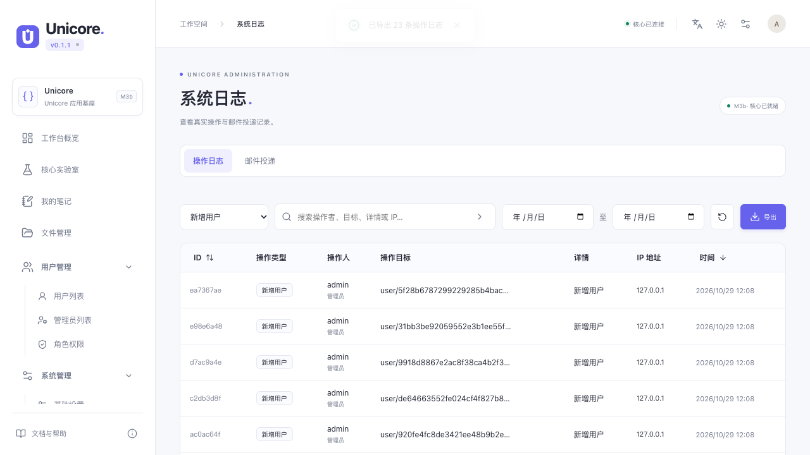
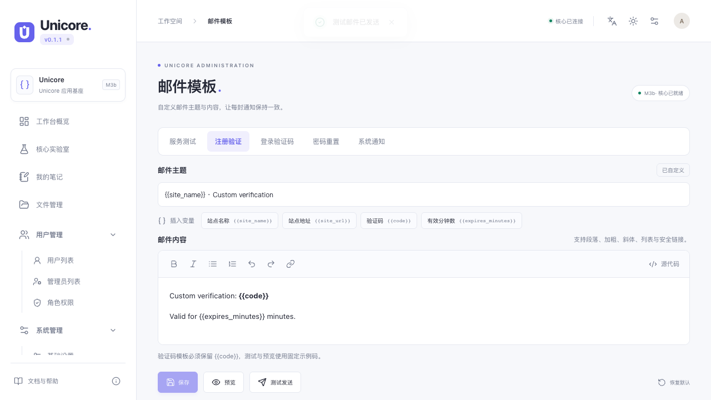

<!-- Author: yunnuo <ymz@ebox.vip> -->
# 管理日志与邮件模板验收

日期：2026-10-29；在 codex/github-ota-signing 工作区验证。规则见 [ADR-0020](../adr/ADR-0020-audit-mail-templates.md)，操作与迁移见 [管理工具](../03-runbooks/admin-tools.md)。本轮不合并 PR 或发布 Release。

| 需求 | web-platform 管理员 | 普通用户 | standalone / desktop / CLI |
| --- | --- | --- | --- |
| 操作日志 | 类型/字面搜索/日期、7 列、稳定排序、分页、CSV | 菜单/页面/API 拒绝 | 不装配 |
| 邮件模板 | 五场景单层 Tabs、主题、富文本/源码、变量、预览、测试、恢复 | 菜单/页面/API 拒绝 | 不装配 |
| 持久化 | 平台迁移 0010、设置复用原表 | 无额外用户配置 | framework schema 仍为 1 |
| 共用前端 | SDK/Form/Modal/Tabs/Message、tokens、中英文 | 无管理模块 | 共用接口兼容、构建回归 |

## 实现与文件

- OpenAPI 为唯一源；生成 Go/TS DTO、约束、operation 与 HTML 参考；SDK 增加日志查询/导出及模板专用方法。
- `internal/audit`、sqlstore/audit、platformsql/logs 与 HTTP logs：服务端身份/IP/目标快照，查询与受限 CSV；`migrations/{sqlite,mysql,postgres}/0010_audit_metadata.sql` 追加表，旧日志保留。
- `internal/mailcontent`、settings/mail_templates、mailer/templates、HTTP mail_templates：内容白名单、转义、注册设置、保存/恢复、实际发送共用渲染。账号验证码流程调用配置渲染；队列仍快照内容。
- `packages/web-ui/src/logs-page.tsx`、mail-templates-page、rich-text-editor、management.css、admin-app/routes 与英文资源：独立管理员装配和响应式页面。
- PRD、架构、权限表、手册、README/Changelog、ADR、manifest、Wiki 源和 add-react-page/add-setting/db-migration Skills 同步，明确覆盖旧的无模板 UI 规则。

## 验证

专项已通过 SQLite/MySQL 8/PostgreSQL 15 的旧库升级、迁移重试、日志查询/分页/字面搜索；外部数据库仅使用本轮随机端口、随机凭据、tmpfs 的专用容器。模板真实配置发送、HTTP 权限/CSRF、IPv6/伪造转发头、安全 HTML、重启持久化和六位码使用自定义模板由 Go 集成测试覆盖。

浏览器使用本机 Chrome，真实 Go 隔离实例，覆盖 1280px/375px：日志日期/搜索空态/排序/翻页/CSV、匿名与用户拒绝，模板草稿切换/预览/保存后重启/隔离 SMTP 发送/恢复默认和英文页面。手机长表格的最小宽度遮挡分页问题已修复；模板页在 720px 高桌面窗口断言全部操作按钮完整可见，长正文只在编辑区滚动。

- `make docs`、`make test` 通过：Go vet/race、边界/契约/作者/文档/双语/设计检查，46 项前端测试和工具测试。
- `make build-web build-cli build-desktop` 通过；macOS arm64 Wails 产物与五档 ICNS 品牌检查通过。最终共享 Modal 的提交事件与链接焦点修复另跑前端测试、类型检查及页面回归。
- 完整浏览器回归 60 项通过、6 项跳过（外部安装 MySQL/PostgreSQL 和 MinIO 的环境未注入）；这不替代本轮三方言 Go 专项，后者全部通过。
- 授权/更新四种编译组合通过（每种 PC/375px 两个场景）；完成后恢复 license=false/updater=true 默认构建。
- 新页面专项最终 4 项通过，包含变量插入、安全源码切换、链接弹窗与保存隔离、矮窗口按钮可见；浅色/英文/375px 实际截图如下。模板测试与 Go 测试使用隔离 SMTP 接收器，真实完成协议投递。

[英文](evidence-admin-tools/templates-en.png) · [日志 375px](evidence-admin-tools/audit-mobile.png) · [模板 375px](evidence-admin-tools/templates-mobile.png)

## 兼容与未测范围

平台 schema 9 → 10；本地 framework 1、业务 1 不变。当前 OTA 拒绝跨 schema 产物；人工 Tar 替换/外部 Docker 镜像升级前必须停服成套备份，回退恢复匹配快照，不能只降级 binary。历史日志缺失字段不补造；代理后实际连接 IP 可能是代理地址。CSV 上限 10,000；邮件队列视图仍为最近 30 个任务。

本轮 SMTP 使用本机隔离接收器，不发送用户真实邮箱或修改其 SMTP/MinIO 配置；不将协议接收声称为公网收件箱确认。未新增邮件通知业务类型、外部日志平台、任意 HTML 邮件或 GUI 管理页面；旧长链接兼容 API 不受新模板配置控制。新管理页面不进入 Wails，原生构建只用于确认接口和组合边界兼容；Windows/Linux 原生运行仍以对应 CI/用户验收为准。
