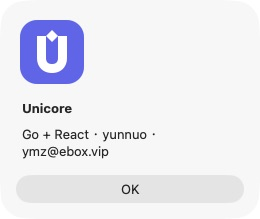

<!-- Author: yunnuo <ymz@ebox.vip> -->
# M2c 验收：设计入口、原生品牌、六位邮件验证码

日期：2026-10-26。基于 23728ed 的 M2b 增量；版本仍为 0.1.0 开发预览。用户授权提交并继续，本次仅本地提交，不推送。

## 需求和形态影响

| 范围 | web-platform | web-standalone | desktop | CLI |
| --- | --- | --- | --- | --- |
| 统一主题/品牌源、Logo/ICO/触屏图标 | 是 | 是 | 是 | 仅品牌默认元信息 |
| 字体/字号、圆角、间距、线宽、动效入口 | 是 | 是 | 共用 UI | 不适用 |
| 原生系统关于/Linux窗口/Windows包图标 | 不适用 | 不适用 | 已接线；macOS 实测 | 不适用 |
| 六位码注册、邮箱登录、找回密码 | 按策略启用 | 无接口 | 不装配 | 不装配 |
| 配套邮件/预览/SMTP验证 | 是 | 不装配 | 不装配 | 不装配 |

主题入口 assets/theme/tokens.json，轮廓源 assets/brand/identity.json；生成器、共享 CSS、Go 模板与原生 shell 统一消费。主要文件：scripts/{generate-theme,generate-brand,sync-brand,check-design,verify-theme}.mjs；assets/{theme,brand,native}；packages/web-ui/src/{brand,theme,account-flows,settings-page}；internal/{platform/email,mailer/template}；adapter/{http/email,mail/mime,storage/platformsql/email}；OpenAPI/SDK 与分方言 0004。详细选择见 ADR-0005 和设计系统文档。

## 自动化与发行

- make test 通过：设计生成/资源同步检查、契约、作者头、5 组实际依赖边界、go vet、Go race tests、TypeScript、Vitest 7 项。
- SQLite、PostgreSQL 15、MySQL 8：同一平台测试组全部通过。覆盖旧版迁移、重复执行、数据保持、验证码持久冷却/错误次数、跨用途/过期拒绝、并发仅一次消费、原子会话创建与改密吊销。
- make build-all 通过：Web、独立 CLI、macOS arm64 Wails 原生应用。原生资源有单独生成前置步骤，首次构建不会依赖旧 build/ 图标；Linux 明确保留原 GPU 策略。
- make release 生成 10 个预览归档，逐一校验 SHA-256、内置 manifest、M2c 与迁移级别（platform 4、standalone 1、CLI 0）。不把交叉编译当作各 OS 原生运行。
- 新邮件 MIME 测试解析中文 Subject/From、multipart/alternative/related、纯文本与真实 CID PNG，验证 SMTP 行长、TLS/STARTTLS 证书及拒绝降级。

## 页面和真实投递

Playwright 10 项全部通过，使用真实 Go 进程、临时数据库和隔离 SMTP sink。31 个页面/状态 × PC、375×812 × light/dark，保存 124 张截图：安装凭据/模式/数据库/管理员/确认/完成；工作台、实验室、外观、仪表盘、用户列表/新增、实例/邮件设置、4 种模板；密码登录、注册/验证码/成功、重发、邮件登录/验证码/错误、找回/重置/成功、权限拒绝。另验证 system 响应和设置重载持久化。后台退出返回概览，避免下个普通用户登录后落到旧管理页。

macOS 原生应用实际逐页操作，使用隔离 APP_DATA_DIR，不用 HTTP 模拟 Wails。Core 分析 hello world 得到字符 11、词 2、行 1 与正确 SHA-256；工作台/实验室/外观/实例设置/关于均验证浅深显示，系统主题选项正常。设置保存后退出/应用包重启仍保留。系统菜单 About Unicore 的图像已明确显示配套 U 标志；打包 ICNS 解码也与品牌相符。保留 12 张原生截图，包括系统关于。原生窗口标题栏遵循 OS 外观，正文主题由应用控制。

单入口替换实验通过：临时只改 brand.accent 为绿色、typography.scale=1.08、shape.scale=1.2，重建真实服务，核对按钮计算颜色、inline Logo、SVG/favicon 与 PNG 像素、字号、圆角、邮件模板、所有工作区页面和 375px；结束后恢复紫色原配置并重建。复现命令 pnpm test:theme；不得与其他构建并行。

经用户明确授权，通过 QQ SMTP TLS 465 向指定测试收件邮箱实际发送 4 封邮件（测试/注册验证/登录/找回密码）。SMTP DATA 均获接受，浏览器中的六位码验证、登录和改密完成。验证码来自仅验收使用的本地发送观察记录，不声称自动读取了收件箱。用户随后确认“已收到，显示正常”。临时明文凭据/验证码观察文件已清理，SMTP 凭据仅保留在被 Git 忽略的隔离实例加密配置中；源码、日志和本报告不包含个人凭据。

## 证据与边界

本机完整截图/摘要：build/acceptance/m2c/{chromium,mobile,native}、evidence.json 和 smtp-result.json；替换实验：build/acceptance/theme-proof/result.json 与截图。build/ 为忽略目录。仓库保留 [页面样本](evidence-m2c/page-samples.jpg) 与 [系统关于](evidence-m2c/system-about.png)，方便后续审阅。

数字验证码 10 分钟、60 秒重发、5 次错误上限，HMAC 摘要；密码重置/状态角色变化吊销待用码与会话。旧 M2b 长链接标记 deprecated 供兼容；新表单不再发送链接。迁移只增平台表，升级/恢复需保留 DB、配置和原密钥，不能承诺只降级 binary 即恢复。

未完成：完整角色/权限编辑、OIDC/绑定策略、品牌上传、备份恢复工具、签名正式发布/在线升级。Docker 完整应用镜像运行、Windows/Linux 原生页面及安装包实测仍待完成；数据库容器通过不代表完整应用镜像通过。任意新主题配色仍需对比度与真实邮件客户端验证。以上没有包装为已交付能力。
