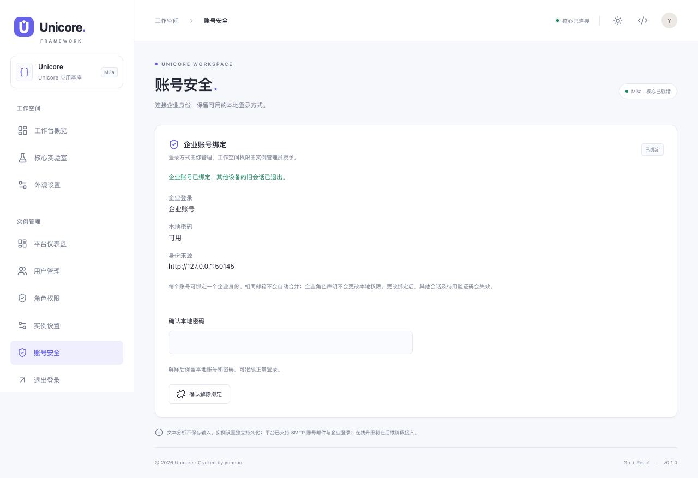
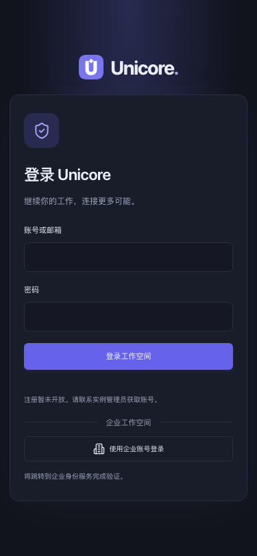
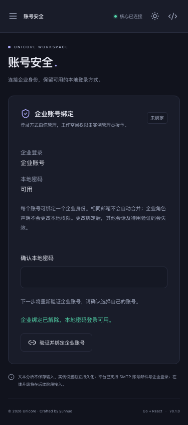

<!-- Author: yunnuo <ymz@ebox.vip> -->
# M3a 企业身份验收

日期：2026-10-26。基线：c49a823（M2d）；环境：macOS arm64、Go 1.25、Node/pnpm、真实 Chromium、PostgreSQL 15、MySQL 8。仅本机测试环境，无外部企业租户、无新增真实邮件投递。SMTP 既有真实收件确认继续有效，本轮回归使用隔离 SMTP sink。

## 需求与影响矩阵

| 范围 | 本轮结果 |
| --- | --- |
| web-platform | 单 Issuer OIDC 配置、发现检查、企业登录、显式绑定/解除、JIT 普通账号、最后本地密码超管保护 |
| web-standalone | 无身份装配、无 OIDC 路由或平台表；原有设置正常 |
| desktop | 共用主题/页面版本，仍只装配本地 Bridge/SQLite；真实原生冒烟通过 |
| cli / Core | 不引入 HTTP/数据库/OIDC/OAuth2，五组依赖图边界通过 |
| 品牌/主题 | 继续使用唯一设计入口，全套图标保持同源；新页面无散落颜色，新增未定义 CSS token 检查 |

需求见 [feature-oidc](../00-product/feature-oidc.md)，决策见 [ADR-0007](../adr/ADR-0007-oidc-identity.md)，接入/恢复见 [运行文档](../03-runbooks/deployment.md)。

## 实现与迁移

主要文件：internal/platform/oidc.go 编排与 port；internal/adapter/oidc/provider.go 发现/PKCE/验签；internal/adapter/storage/platformsql/oidc.go 事务；internal/adapter/http/oidc.go 路由；internal/settings/oidc.go 集中定义；internal/install/manager.go 平台装配；packages/contracts/openapi.json 和生成模型；packages/sdk/src/index.ts；packages/web-ui/src/oidc-page.tsx、登录页/实例设置/导航与共享 tokens；tests/oidcfixture + tests/oidcprovider、Go 集成测试及 tests/e2e/oidc.spec.ts。其余文件为 profile 回归、主题/依赖检查、文档和预览 manifest 更新。

平台新增 0006 两张表 external_identities/oidc_flows，不改 0001～0005 checksum。同组真实三方言测试涵盖空库、0005 升级、重复执行、只持久第一张表后的部分 DDL 重试、已有用户/设置保持和约束。普通 profile 仍为 0001；CLI 为 0。回退需停服恢复成套 DB、配置与原密钥，不依赖删除迁移记录或仅替换旧 binary。

## 验证结果

- `make test`：设计生成/品牌同步/未定义 token 检查、契约生成一致、作者头、五组实际依赖边界、go vet、Go race、TypeScript、7 项 Vitest 全通过。
- 真实 SQLite/PostgreSQL 15/MySQL 8：同组迁移/邮件/角色/OIDC 身份事务全部通过，临时容器已清理。
- OIDC adapter 使用真实 RSA 签名 IdP；成功，错误 nonce/issuer/audience/signature/azp/sub、过期/未来 iat、过旧 auth_time、错误 PKCE、授权码重放均验证。发现重定向/不安全地址拒绝；代码始终启用系统 CA 与 TLS>=1.2。
- 存储与 HTTP：最低 user 权限、不按邮箱合并、未验证邮箱拒绝、身份按 iss/sub 复用、禁用账号拒绝、配置变更拒绝、密码/session 变更拒绝绑定/解绑、旧会话撤销、最后本地超管保护、CSRF/跨站/越权拒绝、密钥掩码、错误浏览器不消费 flow、并发单次消费和过期拒绝。
- `make build-all`：Web、CLI、macOS arm64 Wails 原生构建通过。最后共享 UI 改动后另行重建原生应用。
- `pnpm test:e2e`：16 项全部通过（8 流程 × PC/375px），保留既有安装、邮件、角色、共享 Core 回归；新增 OIDC 正常/邮箱冲突/密码确认/绑定/解除/旧会话失效/本地回退、浏览器凭据缺失、重放、无效签名令牌内容、IdP 不可达、loading 与键盘入口。
- 页面证据：build/acceptance/m3a 下 59 状态 × 2 视口 × 浅深主题 = 236 张，另加两种视口的 system 账号页 = 238 张。截图检查横向溢出，人工复核新 OIDC 15 状态的四组联系图，以及完整账号页/登录页/设置。system 页验证媒体查询 dark→light 实时切换。最后复核补充非平台直接访问 #account 的默认拒绝，两种视口的 4 项 workspace 回归通过。
- `pnpm test:theme`：临时改统一 accent 为绿色、字号 1.08、圆角 1.2，八个工作空间页面（含账号安全）、Logo/SVG/PNG/favicon/邮件与关键尺寸验证通过，最后自动恢复紫色并重建；额外证据位于 build/acceptance/theme-proof。
- 真实 Wails：wails://wails/ 下执行 Core 返回 61 字符/9 词/3 行，检查共享关于页 M3a、系统 About 自定义 U 品牌图标；本轮三张原生截图，历史逐页原生验收继续保留。没有用 HTTP 模拟桌面。
- `make release`：10 个本地开发预览归档，SHA-256、内嵌 manifest、M3a、OIDC 仅平台和 migration_level 6/1/0 核对通过；测试 IdP/实例配置/密钥未进入发布物。仅交叉编译验证非本机平台，不声称已逐系统运行 GUI。

## 页面样例

## 安全审查与未验证项

本轮范围为企业授权、账号关联、配置密钥、会话与本地应急入口。采用成熟验签库，随机 state/nonce/verifier，浏览器凭据与一次性消费，配置/身份事务复核；不保存外部 access/refresh/id_token，不把 IdP 原始错误/code/state 写入日志或最终页面 URL。相同邮箱、企业管理员声明和旧本地会话不能作为绑定/提权凭据。审计只记录 auth.oidc.login/linked/unlinked 与本地用户 ID。

未连接真实企业租户；实际服务商接入仍需登记 HTTPS 回调、确认 PKCE/客户端认证方法及 auth_time。仅支持单 Issuer、每用户一个绑定，未实现 SCIM、角色同步、主动单点退出、private_key_jwt/mTLS。IdP 侧停用不自动吊销既有本地 session，需合理设置会话时长或本地禁用用户。连接检查只验证发现文档与端点地址，不能证明 Client Secret 正确。品牌上传、备份工具、许可证及签名自动升级继续列为后续工作。
