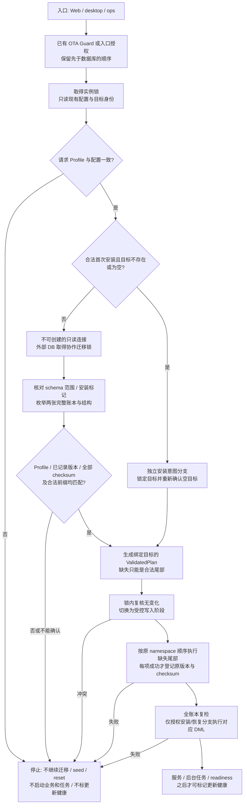

<!-- Author: yunnuo <ymz@ebox.vip> -->
# ADR-0023 草案：单源迁移目录与数据库写前兼容性保护

状态：**已被 [ADR-0024 Pre-1.0 Squash](ADR-0024-pre1-migration-squash.md) 取代，原方案未实施。** 日期：2026-10-30。基线：`cecf28115d3d4d6e36b425557e6c6388e754fae8` + R0 未提交工作区。关联：[ADR-0003](ADR-0003-m2-install-storage-identity.md)、[ADR-0013](ADR-0013-installation-experience.md)、[ADR-0017](ADR-0017-developer-kit-business-backup.md)、[ADR-0021](ADR-0021-business-entities-announcements.md)。

维护者确认仅自身开发测试、无需兼容0.x业务数据，接受 core/platform/module.notes 初始基线和统一 namespace 账本。以下正文保留为此前保守方案的历史草案，不再要求永久保留旧42文件、双账本或兼容0.1.x；写前校验、互斥、只读/失败保护仍由新ADR继承。本文保留原未实施方案的背景，当前目录与运行时边界见 [迁移规范](../02-standards/database-migrations.md)。

本轮不创建目录或生成器，不实施连接、迁移、安装、启动、备份或更新代码。本文的“应/禁止”是提交审阅的约束，不能据此声称当前程序已具备保护。

## 1. 背景与现状

当前 database/sql 迁移由 `internal/adapter/storage/sqlstore/store.go` 和 `business.go` 维护文件列表，版本来自下标。`schema_migrations` 同时记录 framework 1 和 platform 2–12；`business_migrations` 记录 Notes 1–2。三个方言各有 14 个 SQL，共 42 个，均嵌入 Web/desktop。两张账本的旧结构只包含 version/checksum。

checksum 是原始嵌入字节的 SHA-256 小写 hex，先哈希再去注释/分割执行；算法及全部旧 SQL 必须保留。当前执行器先建账本，再逐个检查/执行，无法识别完整账本的未来版本或中间缺口；较晚 checksum 错误前可能已经提交了较早迁移。桌面在核对 Profile 前迁移；通用 SQLite Open 会先创建文件/设置 WAL。备份/恢复和发行/OTA 有多处手写当前等级，恢复没有对比完整账本。

这些风险不能靠更新 README 中的数字解决，也不应通过重新实现一套迁移引擎解决。本提案保留现有 SQL、账本、两个命名空间、正向执行顺序和安装 seed 事务，补单源定义、只读观察和执行门禁。

## 2. 目标、范围与非目标

目标是让预期迁移集合有单一来源，在任何持久数据库写入之前识别不兼容数据；合法历史前缀才可正向补齐。未完成安装与普通已安装升级必须有不同授权条件。备份/恢复复用判断，不能以 manifest 数字代替数据库事实。

| Profile | 目录能力及保护范围 | 验收约束 |
| --- | --- | --- |
| web-platform | SQLite/PG/MySQL，framework 1–12 + business 1–2；安装/启动/ops | 三方言逐项真实测试，不将一种方言通过推广到另外两种 |
| web-standalone | SQLite/PG/MySQL，framework 1 + business 1–2 | 拒绝平台专属账本/标记，不自动转为 platform |
| desktop | 仅 SQLite，framework 1 + business 1–2；真实 Wails 启动/ops | Windows/macOS/Linux 分别验证只读文件/WAL 行为；不以 HTTP 模拟桌面 |
| cli | 生成发行元数据的 DB 等级为 0/0，程序不读取目录、不嵌入 SQL、不连接 DB | 实际依赖图不得出现 database/sql、驱动或迁移资产；`cmd/ops` 不计入此 CLI |

不引入新迁移、ORM、通用动态插件、模块独立账本、自动逆向 SQL、跨方言数据转换或完整 schema 指纹系统。不改 OTA 的发布者签名、免费发行策略、manifest 字段与平台签名政策；只统一其现有迁移等级来源。没有缩小已列 Profile、DB、OS、tar/Docker 支持范围；未完成原生验收时保持“待验证”，不能默认改为不支持。

## 3. 单源目录与派生元数据

### 3.1 拟议 `migrations/catalog.json`

以下是完整的当前定义示例，**仅存在于本文，不是已实施文件**。`version` 使用原账本值，`file` 使用原文件名；目录相对 `migrations` 解析为 `<dialect>/<directory>/<file>`。`namespace_order` 保留现有 framework 全部完成后执行 business 的顺序。

```json
{
  "format_version": 1,
  "checksum_algorithm": "sha256-raw-v1",
  "dialects": ["sqlite", "postgres", "mysql"],
  "profiles": {
    "web-platform": {"dialects": ["sqlite", "postgres", "mysql"]},
    "web-standalone": {"dialects": ["sqlite", "postgres", "mysql"]},
    "desktop": {"dialects": ["sqlite"]},
    "cli": {"dialects": []}
  },
  "namespace_order": ["framework", "business"],
  "namespaces": [
    {
      "id": "framework",
      "ledger_table": "schema_migrations",
      "directory": ".",
      "migrations": [
        {"version": 1, "file": "0001_framework.sql", "profiles": ["web-platform", "web-standalone", "desktop"]},
        {"version": 2, "file": "0002_platform.sql", "profiles": ["web-platform"]},
        {"version": 3, "file": "0003_platform_mail.sql", "profiles": ["web-platform"]},
        {"version": 4, "file": "0004_email_challenges.sql", "profiles": ["web-platform"]},
        {"version": 5, "file": "0005_role_management.sql", "profiles": ["web-platform"]},
        {"version": 6, "file": "0006_oidc.sql", "profiles": ["web-platform"]},
        {"version": 7, "file": "0007_fixed_roles.sql", "profiles": ["web-platform"]},
        {"version": 8, "file": "0008_separate_administrators.sql", "profiles": ["web-platform"]},
        {"version": 9, "file": "0009_file_storage.sql", "profiles": ["web-platform"]},
        {"version": 10, "file": "0010_audit_metadata.sql", "profiles": ["web-platform"]},
        {"version": 11, "file": "0011_announcements.sql", "profiles": ["web-platform"]},
        {"version": 12, "file": "0012_multipart_uploads.sql", "profiles": ["web-platform"]}
      ]
    },
    {
      "id": "business",
      "ledger_table": "business_migrations",
      "directory": "business",
      "migrations": [
        {"version": 1, "file": "0001_notes.sql", "profiles": ["web-platform", "web-standalone", "desktop"]},
        {"version": 2, "file": "0002_notes_lifecycle.sql", "profiles": ["web-platform", "web-standalone", "desktop"]}
      ]
    }
  ]
}
```

`sha256-raw-v1` 只是给已有算法命名：`lowercase_hex(SHA256(raw_file_bytes))`。不添加盐、不规范化行尾、不去作者头、不对 JSON 求哈希来替代 SQL checksum。

目录只维护预期集合、身份、原版本、文件引用、适用 Profile/方言和顺序；**不维护当前最大版本、checksum、执行状态、应用 VERSION 或数据库内容**。文件中的 SQL 是迁移内容的唯一来源，账本是实际执行事实的唯一来源。不得从账本反向补生成“应该执行”的定义。

### 3.2 生成及消费者

拟议生成器 `scripts/generate-migrations.mjs` 读取目录与原始 SQL，生成：

- `migrations/catalog.gen.go`：数据库运行/运维使用的显式版本、SQL 引用、Profile 筛选、原字节 checksum 和派生等级；不导入驱动或平台身份。
- `migrations/metadata.gen.json`：发行脚本/工具消费的同源投影，包括 Profile/方言的预期版本集合和等级。CLI 的空集合派生 0/0；业务 CLI 不 import `migrations` 包。

名字可在实施审查中细化，但两个产物都必须标记 generated、可重复生成且不能手改。构建/质量/打包执行 `--check`，验证生成结果与目录/嵌入 SQL 一致；不能只靠开发者记得 `go generate`。消费者使用同一投影，不再各自手写 12/2。工具记录的备份源版本仍由只读 inspection 获取，不用当前生成等级覆盖源库历史。

目录校验要求：拒绝未知字段/格式、重复命名空间/版本/路径、错序/非正整数、未登记 Profile/方言、非法表标识、路径越界/链接、缺失方言文件、SQL 文件未登记，以及生成漂移。版本来源是显式 version，禁止再用列表长度或位置重编号。当前历史集合必须保持原值；未来添加只能追加，不在旧序列中插入或复用版本。

42 个旧文件与可信前版源码/发行 fixture 逐字节比较，跨 OS 检查实际嵌入字节。哈希清单是生成/审计结果，不能成为第二份需要手填的定义。若发现历史 Windows CRLF 账本，停止并单独审阅兼容方案；本 ADR **不授权**接受规范化哈希、批量替换 checksum 或修改原 SQL。不要在此任务顺带增加会改变历史 checkout 字节的行尾转换。

### 3.3 不变的数据库事实

保留两张旧账本的名称、两列结构、version 和 checksum。目录引入本身无需迁移。不 backfill execution time、不加“已验证”记录、不删未知行、不修 checksum。只有成功应用原始 SQL 后，迁移执行器才可按原版本登记；显式新目标恢复导入的是历史执行记录，不能被描述为任意修复账本的授权。

未来可配置业务模块的独立命名空间需另行设计，不把本轮 business/Notes 1–2 挪入新模块账本。

## 4. 只读数据库检查策略

### 4.1 API 与连接边界

拟在 `sqlstore` 的纯检查/计划逻辑与 `sqlite`/`webdb` 的连接适配中分离：`Inspect` 返回观测值及分类，`Plan` 结合目录和可信启动意图返回不可绕过的 `ValidatedPlan`；`Apply` 只接受有效计划。检查逻辑不能调用建账本、Migrate、Reset、SaveSettings、Seed、审计写入或 secret/config 自动初始化。

读取已安装配置和密钥应使用“仅打开已有文件”的路径，不得因检查失败创建新的实例身份、密钥或 DB。安装意图文件/锁文件与数据库持久写入分开描述：首次安装可以按既有授权记录意图；已安装冲突不得被重新标成未安装。日志使用 stderr/已有日志系统，不把兼容错误写回待检查数据库。

| 方言 | 拟议检查连接 | 禁止与注意点 |
| --- | --- | --- |
| SQLite | 先确认现有普通文件/身份，再以不可创建的 `mode=ro`、连接级只读限制打开；不调用当前 Open | 不设置 journal_mode、不 checkpoint、不修复 hot journal；不以 `immutable=1` 忽略有效 WAL。`mode=ro` 本身不能代替 sidecar 零写入验证：不同 OS/VFS 的 WAL/SHM 条件必须实测，无法只读读取则拒绝并提示停服制作受控快照，不降级成 readwrite |
| PostgreSQL | 固定连接、明确数据库及 public schema，使用只读事务/一致快照，查询限定 schema 的系统目录和基础账本表 | 防止隐式 search_path 解析到用户同名对象；session 设置不是持久 DDL/DML。不能因查询失败推断为旧版本或空库 |
| MySQL | 固定连接、明确 DATABASE()，显式 READ ONLY 事务/一致读取，查询 information_schema 与真实基础账本表 | DDL 隐式提交仍属后续 apply 的风险；检查不执行“无害”CREATE IF NOT EXISTS。不能用权限不足伪装成账本缺失 |

连接、单条查询和整体检查都要有有限超时及 context 取消；不继承任意无限超时。校验 ledger 必须是预期基础表而非同名视图，检查关键列、主键、非空及值格式，再读取完整有序账本；设结果数量上限，超出预期规模直接拒绝，禁止回退到只读 MAX。检查 SQLite 不能创建/改写 DB、WAL、SHM；文件系统正常读取产生的 atime 或数据库服务器自身日志不等同应用 DDL/DML，不承诺阻止这些系统行为。

SQLite 是否能满足该文件约束是 R1.2a 的技术验收门槛。实现必须在打开目标之前排除会创建辅助文件/需要恢复的布局，并使用可证明限制辅助文件写入的 OS 访问边界或只读 VFS；不能先让驱动创建 SHM，再在出错后声称安全拒绝。若现有驱动/OS 组合无法证明，应在连接前返回 unavailable，另走停服后受控一致快照的运维路径；不能直接复制正在变化的 DB/WAL 来冒充一致快照。具体可用连接方式先在隔离原生矩阵验证，再装配启动代码。

### 4.2 并发与检查后使用

现有目录 flock 只保护同一目录，不能保护两个目录指向同一个外部 DB。建议迁移阶段使用数据库级协作互斥：PG session advisory lock、MySQL named lock，以数据库/应用范围标识，不按实例 ID 各锁各的。锁本身不创建表或持久业务行，使用有限等待并确保释放。

外部数据库在同一固定连接上持有锁，完成只读全账本检查，结束只读事务后执行已验证计划，再复检。MySQL 锁不能使用会被 DDL 隐式提交释放的事务锁来替代。SQLite 保持实例锁，控制只读/写连接交接并核对路径、inode/文件身份和账本未变；禁止路径替换后应用旧计划。

计划绑定目标身份、Profile、目录摘要和完整观测账本；执行前核对或在同一锁下重新检查，不可跨连接池任意对象复用。任何冲突重新检查或拒绝，不重复盲跑。协作锁不构成多副本无停机升级承诺，也不能阻止外部 DBA 或旧版进程无视锁修改数据库；升级仍要求停服。原生锁语义和各数据库权限需实际验收。

## 5. 写前判断及启动流程



图中 ops 共用的是检查逻辑，不表示备份或恢复执行迁移：备份检查后导出；恢复使用第 7 节的独立导入分支；只有应用启动/正式安装会生成迁移 apply 计划。首次 Web uninitialized 状态可以仅提供安装页，不装配业务服务；数据库检查失败不能回退成新的 `/install` 初始化入口。

判断顺序：

1. 先确认配置状态、目标数据库/文件身份、请求 Profile 与已保存 Profile。Web override 冲突在 recover 前拒绝。已安装 SQLite 文件缺失立即拒绝，不创建。
2. 连接成功后先观察关键表/所有账本结构及安装标记，不创建任何表。标记要求唯一有效 `id=1`，Profile/instance 与可信本地记录一致；多余标记行/错误类型/同名视图不能仅按 SELECT id=1 接受。
3. 枚举 **两个命名空间全部行**。只接受正整数原版本、64 位小写 hex 原 checksum；拒绝当前目录没有的行、当前 Profile 不允许的行、超出能力的未来行及不合法结构。
4. 每个命名空间的已执行集合必须是其适用目录顺序的完整前缀；比较所有已记录 checksum 后才生成缺失尾部计划。不能先执行 framework 再发现 business 不兼容；也不能用 MAX 正常来掩盖中间缺行。
5. 兼容旧版缺 business 账本只允许在已知旧历史前缀、无业务表且 owner 合法的条件下解释为业务尚未引入。存在 Notes 表但缺账本属于未跟踪状态，不能反推迁移已执行并补账本。framework 缺账本但已有框架表同样拒绝，除非是有明确 ownership 的首次安装中断状态且通过逐项恢复规则。
6. 两个命名空间各自前缀有效不是所有组合都曾发布的证明。需要用历史源码/升级 fixtures 验证受支持起点，并检查关键对象与相互依赖；不得自动宣称所有 schema×business 组合都可升级。定义中的预期集合仍唯一，不另手填一张当前等级表。
7. 缺失尾部涉及 MySQL 部分 DDL 时，验证已知列/索引/约束与数据搬迁前置条件。仅结构符合已审查的幂等恢复规则才继续；列存在不是完整成功证据。不改旧 SQL，仅在执行边界做明确检查。无法判定时不登记版本，要求恢复匹配快照。
8. 迁移后重新检查所有账本及关键结构；首次安装再执行原有 marker/默认设置/管理员/审计的单事务 seed。普通升级不能补 seed 或重新初始化业务数据。只有成功之后才 attach、启动 worker、开放业务和标 OTA healthy。

全账本一致说明迁移元数据兼容，不证明所有业务表从未被手工改动；本阶段检查关键账本/标记及重试所需结构，全面 schema 漂移检测不在此范围。

## 6. 异常处理及中断安装

错误对运维输出稳定类别和安全上下文：Profile、namespace、版本及失败阶段；不输出 DSN、密码、密钥或用户数据。以下名称是设计类别，不是已发布错误 API。

| 状态 | 拟议结果 | 恢复方式 |
| --- | --- | --- |
| 当前全部匹配 | 无迁移计划，正常启动 | 不改账本、设置或默认数据 |
| 合法旧前缀，owner 匹配 | 停服/锁内补齐尾部 | 升级前保留匹配快照；失败按方言处理 |
| 未来/未知版本，包括零/负数 | `schema_future` / `ledger_unknown`，零数据库写入 | 使用支持该库的程序，或另目标恢复旧快照；不删除版本行 |
| 中间缺行，后续版本仍在 | `ledger_gap`，不重跑缺项 | 诊断备份/人工改动来源，恢复完整可信快照 |
| 任一命名空间任一 checksum 不符 | `checksum_mismatch`，必须在所有迁移前拒绝 | 核对可信原始包与字节，不能覆盖 hash 或自动接受标准化 SQL |
| Profile、instance、schema 范围或 DB 身份冲突 | `ownership_mismatch` | 使用正确配置/目标；另行设计数据迁移，不直接切换 Profile |
| 已安装配置但缺 DB/账本/marker | `installation_inconsistent` | 不重新安装、不建空库，恢复匹配 DB/config/key |
| 权限不足、查询错误、只读 WAL 不可打开、超时 | `inspection_unavailable` | 修复权限/停服/提供受控快照再试；不按“无账本”处理 |
| 普通全新空目标 | 仅明确 install/桌面 first-run 分支创建 | Web 仍要求 bootstrap 授权；目标须在锁内复核 |
| UNINITIALIZED 但有未跟踪的 Unicore 表/账本 | 拒绝接管，不 reset | 使用新空目标或恢复原实例；不能把异常识别成普通外库 |
| 普通第三方非空库、无 Unicore 痕迹 | 只保留 ADR-0013 的独立显式 reset 授权流程 | 精确目标名、明确清空同意、合法 dedicated scope；启动永不调用 reset |
| INSTALLING/FAILED + OwnsSchema=false | 不自动连接/接管重试 | 重新明确授权检查目标；未来/未知状态仍拒绝 |
| INSTALLING/FAILED + OwnsSchema=true，目标/Profile/身份及合法前缀匹配，无已提交 marker | 允许有界恢复到待完成安装；Web seed 仍要求安装凭据 | 不能因状态名而忽略缺口/未知 checksum；MySQL 尾部单独判定 |
| DB marker 已提交、本地最终记录未完成 | 保留现有恢复能力：先完整校验，owner 相同才完成本地配置 | 不重跑管理员初始化，不覆盖原身份 |
| MySQL 已有部分 DDL、不能证明匹配 | `partial_migration`，停机，保留现场 | 在新空目标恢复匹配快照，不自动 drop、删账本或补登记 |

桌面目前只有 DB 内 marker，没有 Web 的外部安装状态。如果 DB 和所有本地历史一起被移除，程序无法凭空区分真正首次运行与人为丢失数据。本方案只对仍有证据的情况做保护；无 marker 的**非空**库必须拒绝。若需要桌面“所有删库后仍禁止首次创建”，应另审阅外部 ownership 记录，不在本 ADR 伪造版本元数据来承诺这点。

启动失败返回非零，不 attach 业务服务；若未来提供诊断 HTTP，也只能是独立只读运维入口并保持 readiness 失败，不能继续正常流量。不得为记录错误而向拒绝的库写审计。更新 Guard 仍在数据库前运行，数据库验证失败不得调用 MarkHealthy；自动回滚二进制不能豁免旧程序对未来 DB 的拒绝。

## 7. 备份、恢复、升级的衔接

**备份**：继续停服/持有实例锁。先只读检查 owner、两张完整账本和 checksum，再取快照；manifest 中 schema/business_schema 是经验证的源库观察值。只有确实缺少且满足旧版条件的 business 账本才能记 0，不能吞掉任意 SQL 错误。SQLite snapshot 操作在检查成功后进入受控导出阶段，源库不执行迁移或业务 DML；只读检查本身不得开启 WAL。数据库外部写入不受目录锁保护，需遵守停服/原生快照前提。

**恢复**：继续新目录和明确确认的空专用目标。先验证加密归档、成员校验与 manifest 的 Profile/方言/非负版本合理性，检查本地配置记录一致性。SQLite 对复制出来的 DB 做只读完整检查；PG/MySQL 的 SQL dump 无法在导入前当成真实数据库检查，允许一次**明确授权的新空目标原生导入**，这会创建表并恢复原账本。导入之后，在任何 restoreCloud/设置/凭据 DML 或目录发布之前，检查完整账本、checksum、marker、instance、配置和 manifest 的真实一致性。dump 的 schema 数字不能替代导入检查。

恢复不执行迁移；兼容的旧快照可以先原样恢复，再由应用启动按前缀升级。format=1 的旧备份应保持可读，不为添加目录强制修改格式；如新增可选生成证据，仍需从实际源库观察值派生。未知/未来/缺口/负数、manifest 与导入账本不符必须拒绝。MySQL 导入失败可能留下部分**新目标**，不发布数据目录、不回写源桶、不自动删除目标；提示换另一空库重试。

R1 只建立并接入检查边界；真实历史版本→备份→升级→故障→恢复的完整演练、PG 原生工具 DSN 选项兼容等在 R2 独立验收。安装允许清空与恢复导入均为显式异常分支，不能成为普通启动的兼容性绕过开关。

## 8. 兼容性、失败与回退

- R1.1 目录/生成变更不需要 DB migration；旧账本、SQL 和 checksum 均原样。原有 release/OTA 目标字段继续输出同值，不能借生成器重写历史发行签名清单或备份源版本。
- R1.2 会有意拒绝原先侥幸能启动的未来版本、账本缺口及未跟踪结构。这是行为收紧，发布前必须在克隆/快照中提供只读预检及运维说明；不能默认在生产首次启动才发现。不得提供 `skipValidation` / `force` 生产后门。
- 有效旧数据仅正向迁移；SQLite/PG 每项事务回滚，前面已成功项仍保留。MySQL 保留部分失败现场，只有已验证尾部恢复规则可重试。跨两张账本不承诺总事务。
- 目录代码出错可撤回代码并保持同一 SQL/账本内容；撤回保护代码不是旧二进制使用未来 schema 的安全证明。数据库升级后的回退要求匹配旧 binary + DB/data/config/key 快照恢复到新目标；不执行 down SQL，不改 checksum，不删 ledger。
- 不自动修复损坏账本。若未来确需人工恢复工具，必须另审阅设计、可信证据与权限，不复用 installer reset。
- 原生 SQLite/WAL 和外部锁未验收不能标“已实现且全支持”。没有新生产验收就保持待验证；不通过删掉某种 OS/数据库来无声降低门槛。

## 9. 测试矩阵与验收标准（未来实施）

本节为 R1.1/R1.2 的计划，本轮没有运行这些数据库测试。每项结果分别记录代码、构建、自动化、原生 OS、生产，不互相替代。

| 组 | 输入/故障矩阵 | 必须观察到的结果 |
| --- | --- | --- |
| 目录单源 | 14 定义/42 SQL，三方言、四 Profile、重复/缺失/越界/错序/未登记文件/生成漂移 | 显式原版本与字节完全保留；错误构建失败；运行/发行/ops 当前等级相同；CLI 空集合且无 SQL 依赖 |
| 当前与旧库 | 三方言 Web 两 Profile、SQLite desktop；当前重复启动、已证明历史前缀及业务尚未引入 | 当前无重复 SQL/seed；旧数据、ID、角色/附件关系保留，补齐尾部后完整账本正确 |
| 版本异常 | framework/business 分别插入未来 999、未知/零/负数，中间洞，Profile 禁用行 | 在任何建表/账本 INSERT/设置/标记/管理员/业务初始化之前拒绝；不能仅检查一张账本 |
| checksum | 首项、末项、business 项错误；单字节/作者注释/行尾/BOM 变化 | 任意一项错误全局写前拒绝；无 normalize/覆写账本；历史包跨 OS 原始字节证据齐全 |
| 所有权/连接 | Profile/instance/APP_PROFILE 冲突，错误 PG search_path，非 dedicated schema，同名视图/账本列损坏，权限不足、超时/取消 | 分类错误，无接管/补种/误判空库；日志不含秘密；服务/worker/healthy 不启动 |
| 首次与中断安装 | Web state×OwnsSchema×marker，已提交 DB+未完成 JSON，缺 DB、空 marker、无账本有表、非法多 marker；desktop 空/非空无 marker | 合法授权分支继续；旧实例缺库不补建；不重复管理员 seed；不明状态不 reset |
| MySQL 部分 DDL | 每个已支持尾部的执行/登记间中断，重点 7/8 和 business 2；列存在但类型/默认值/索引不符 | 只对经证明的幂等状态重试；不完整状态不伪造账本，不泛化为自动修复 |
| SQLite 文件只读 | 三个 OS，DB-only、已有 WAL+SHM、WAL 无 SHM、只读目录、hot journal、缺文件、特殊字符/Windows 盘符 | 拒绝路径不创建/改写 DB/WAL/SHM；不能 immutable 忽略数据；不能 RW fallback。比较文件集合、内容 hash/mtime 与 DB 行；数据库逻辑零写与文件零写分别给证据 |
| 并发与 TOCTOU | 同目录两进程、不同目录同外库、锁超时/崩溃、检查后路径/账本变化、连接池换连接 | 最多一个 migrator，计划不能应用到别的目标；冲突安全拒绝；锁释放可靠 |
| 恢复边界 | format1 旧档，manifest 负数/未来/Profile 错、完整归档但账本或 config 不符，导入中断 | 新目标导入例外可观察；检查失败后无 restoreCloud/设置 DML、无目录发布、无源桶写入；不自动清理外部部分库 |
| 失败证据 | 对每个拒绝例比较 schema/账本/marker/settings/admin/业务数据前后；SQL 记录/只读权限；SQLite 文件快照 | 不能只断言 error；证明无目标持久写入。测试数据库和临时目录独立、绝不指向真实环境 |
| 现有回归与原生 | 修正挖洞的历史 fixture、make docs/test、相关 Profile 构建、Windows/macOS/Linux 真实启动及更新失败拒绝 | 不降低既有授权/签名/CLI 边界；CI 构建成功与真实 Wails 窗口测试分别记录；生产演练另记 |

数据库版本先沿用当前实际验收基线 PG15/MySQL8.0，其他版本不自动算通过。具体服务器/OS/arch、从版本、命令、pass/fail/skip、SQL 与数据差异需要进入实施验收报告。不能用历史 R0 三方言日志用例证明新 guard 已通过。

## 10. 小阶段及待审阅决策

| 阶段 | 拟涉及位置 | 独立验收与回退 |
| --- | --- | --- |
| R1.1a 定义/生成 | `migrations/catalog.json`、`assets.go`、生成器/生成产物及静态测试 | 42 字节不变、版本/命名空间不变、生成可重复；无需 DB 变更，撤回仅代码 |
| R1.1b 消费者 | `sqlstore/store.go`、`business.go`、`bootstrap/updating/runtime.go`、`maintenance/snapshot.go` 的预期元数据部分、release/release-assets、当前目标测试；manifest/Makefile/package 命令；db-migration Skill/运行文档 | 替换预期集合与等级来源，不先实施 DB 校验、不改变执行语义；历史 fixture 数字保留事实身份 |
| R1.2a 只读检查 | `sqlstore/inspect.go` 或专用检查文件、sqlite/webdb 检查连接与锁适配、三方言测试 | 完整账本/分类/文件零写，先不接业务启动；不能创建新账本迁移 |
| R1.2b 启动/安装 | `install/manager.go`、`bootstrap/local/local.go`、必要的现有密钥只读打开能力、server/desktop 装配测试；历史升级 fixture、安装/升级手册 | 权限和状态先检查，后迁移/seed；完整回归与原生拒绝验收，数据回退使用快照 |
| R1.2c ops 衔接 | `maintenance/snapshot.go`、`archive.go`、snapshot/database 测试、backup 手册 | 观察值和预期值分开；导入后检查早于改写/发布；format1 不破坏，无新迁移 |
| R2 关联演练 | `scripts/test-upgrade.mjs`、真实历史 fixtures、维护工具 DSN 测试/实现、备份恢复/升级验收 | 另获授权后做跨版本和故障演练，不将本 ADR 当作通过结果 |

每步同步对应需求/架构/运行文档及验收；若改变已接受 ADR 边界，在实施时明确替代条款。本草案未取代旧 ADR 的当前实现事实。

需要维护者审阅的是目录表示、严格前缀拒绝策略、只读连接与锁、MySQL 有界恢复、恢复导入例外及细分顺序。审阅通过后再授权 R1.1/R1.2；**当前工作在审计与草案完成后停止**。
