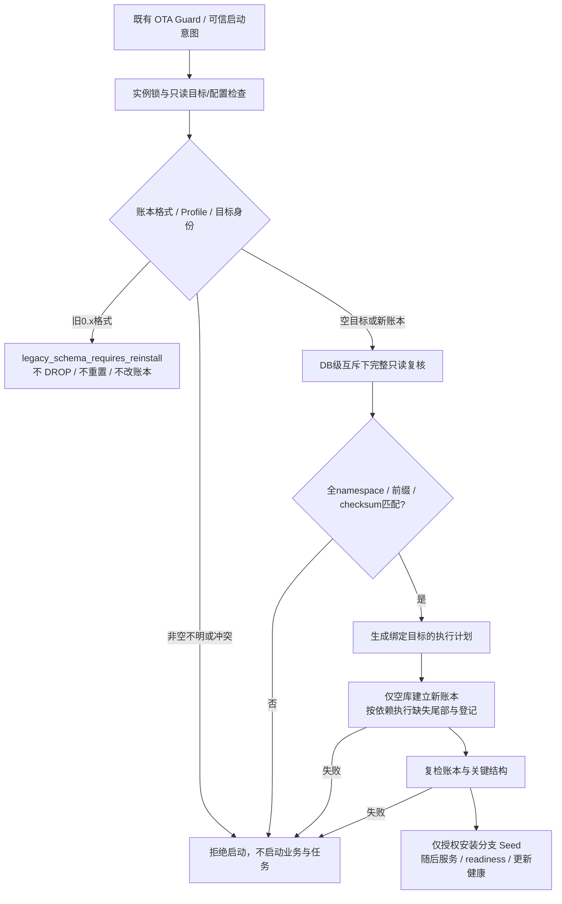

<!-- Author: yunnuo <ymz@ebox.vip> -->
# ADR-0024：Pre-1.0 数据库基线重建

状态：**维护者已接受架构方向与 0.x 数据政策；R1.0a 还原及 R1.0b 新基线/Catalog 验收已完成，R1.0c 执行器和启动保护尚未实施、未获本轮授权。** 日期：2026-10-30。取代 [ADR-0023](ADR-0023-migration-catalog-startup-guard.md) 的历史迁移永久保留、双命名空间及旧账本兼容方案；保留其写前检查、只读边界、互斥和安全失败原则。当前资产与运行时关系见 [迁移目录](../../migrations/README.md)。

## 背景与决定

维护者明确确认只有开发者自己的开发/测试使用，没有外部用户或需要保留的真实业务数据库，不要求 0.1.x 开发数据库升级到新世代。此前确有公开开发预览，并不改变维护者本次明确接受的不兼容政策；不能再用“可能有外部用户”推导必须保留全部历史迁移。

因此接受 Pre-1.0 Squash：正式目标迁移为 core、platform、module.notes 三个独立命名空间，三个方言各一份 version=1 初始 SQL。最终旧 42 文件仅在 Git 历史保留；移出活动目录和 embed 是 **R1.0c 后续任务**，R1.0b 明确保留全部旧文件及旧入口，当前未删除或修改。

R1.0a 已真实执行七组历史迁移并导出目录，平台 30 表/164 字段，本地 6 表/24 字段（均含两张旧账本）。三种方言的 0007/0008 带数据试验通过，所需最终结构及基础数据已经确认；不是历史 SQL 拼接形成新基线。

## 新边界

| 命名空间 | 内容 | Profile |
| --- | --- | --- |
| core | install_state、system_settings、audit_logs 三表；不包含账号/文件/邮件 | Web 两形态、desktop |
| platform | 24 张平台表，含独立管理员/用户、角色权限、邮件/OIDC、文件/审计快照/公告/上传会话 | 仅 web-platform |
| module.notes | 最终 example_notes，直接含 deleted_at 与两条查询索引 | Web 两形态、desktop |

web-platform=core+platform+module.notes；web-standalone=core+module.notes；desktop 同本地组合且仅 SQLite；CLI 无 DB/SQL/迁移包。SQLite/PostgreSQL/MySQL 的 Web 支持范围不缩小。平台表不得泄漏到本地形态。

预期迁移集合仅由 `migrations/catalog.json` 定义；原 SQL 是执行内容及 SHA-256 的来源。目录不维护可漂移的最大版本/checksum 手填副本，运行/发行/运维元数据均生成。正式定义见 [Catalog](../../migrations/catalog.json)，具体语义见 [ADR-0025](ADR-0025-baseline-catalog-semantics.md)。

```text
migrations/
  catalog.json                         # 唯一新世代定义，R1.0b 已创建
  assets.go                            # 未来调整 embed
  catalogdata/catalog.gen.go / metadata.gen.json  # R1.0b 生成，只读投影
  core/{sqlite,postgres,mysql}/0001_initial.sql
  platform/{sqlite,postgres,mysql}/0001_initial.sql
  modules/notes/{sqlite,postgres,mysql}/0001_initial.sql
```

九份正式基线来自历史最终结构还原：Notes 已融合业务 2 的最终列/索引；平台直接创建管理员七表，不复制 users；不执行 0007 的清理或 0008 的搬迁。SQLite 文本主键显式非空是草案中的有意修正，R1.0b 必须真实验证。VARCHAR 长度、用户名排序规则等方言差异不可无声“规范化”。

统一账本 `schema_migrations(namespace,version,checksum,applied_at)`，联合主键(namespace,version)，四列显式非空。applied_at 为实际执行 UTC Unix 秒，只有该项成功才与对应事务登记。账本引导 DDL 由 catalog 账本结构生成，不在九份 SQL 重复创建。不再创建 business_migrations。R1.0b 独立空库 fixture 已实测平台 29 表、本地 5 表；正式新执行器尚未实施，不能将 fixture 当作产品启动验收。成员/依赖顺序及 core@1 世代锚点的持久化细则见 [ADR-0025](ADR-0025-baseline-catalog-semantics.md)。

角色、权限及管理员继续由现有 Go Seed 负责；默认设置、实例标记、ID/密码哈希/密钥/安装凭据由安装/运行期生成。SQL 仅保留 local 与 legacy-brand 两个无凭据静态存储位置；后者尚有品牌 fallback 代码引用，删除应另审阅。基线不包含真实/演示用户、密码、密钥、队列、笔记或公告内容。

## R1.0c 必须满足的执行与启动保护

本节是后续实现约束，**当前旧执行器不具备这些新保证**。



1. 旧账本两列 version/checksum 或旧 business_migrations 被识别时，在任何写入前返回 `legacy_schema_requires_reinstall`；不得自动 ALTER、DROP、清空、重建或补造 namespace。混合新旧账本也拒绝。
2. 完整枚举所有 namespace/version，校验账本结构、正版本、已记录原字节 SHA-256、适用 Profile、顺序与完整前缀。未来、未知命名空间/版本、缺口或 mismatch 均在迁移/seed 前拒绝。不能只查 MAX 或只检查 core。
3. 已安装标记、配置/Profile/instance 与目标身份先验证；没有标记却已有不明表不得视为新库。只有明确授权的空库安装可以创建账本和 Seed。启动失败不得回退成自动重装。
4. SQL/目录中的 namespace/version 是预期；账本只记录实际成功事实。重复启动不重跑，不实现 force、skipValidation、删账本或覆写 checksum 后门。
5. SQLite 使用真实不可创建的只读连接/访问边界，开库前判断 WAL/SHM/热日志条件，不能先创建文件再判断兼容。不用 immutable 忽略有效 WAL，不可读时拒绝，不回退 RW。三 OS 的 DB/WAL/SHM 内容/mtime/文件集合需要专门测试。本轮仅执行历史可写 Open，**没有验收未来只读保护**。
6. PG 使用固定连接、限定 public、只读检查和 session advisory lock；MySQL 固定连接/READ ONLY 检查及 named lock。锁覆盖检查→apply→复检，不能被 DDL 隐式提交释放；目录 flock 不能替代外部 DB 级互斥。SQLite 连接交接防路径/文件替换。协作锁不承诺多副本在线无停机升级。
7. SQLite/PG 每个迁移内 SQL+账本事务提交；MySQL 必须承认 DDL 隐式提交，系统基础 DML/账本尽量在最后同一 InnoDB 事务内登记。无账本的部分基线不能凭 IF NOT EXISTS 或“某列存在”判断成功；无法证明的部分状态停止，提示另用空目标重装，不能自动 drop。受支持的未来尾部重试必须逐项证明结构前置条件。
8. 检查有总时限、取消、有限锁等待，失败写安全日志，不向被拒绝 DB 写审计，不启动 worker/业务，不标 OTA healthy。保留现有 OTA Guard 先于 DB 的顺序。

## 0.x 政策、备份与发行

0.x 开发数据库不承诺升级至新世代；不开发迁移桥接。旧备份只能用匹配旧代码/数据/密钥在隔离旧环境恢复，不能导入新世代后篡改账本冒充兼容。新世代保留备份/恢复功能和三方言范围，另设计真实 namespace 版本向量、世代标识及格式版本；签名 OTA 目标同样不能继续用两个标量表达三个命名空间。

首次包含新基线的应用发行应使用新的应用版本，不能覆盖 v0.1.1、其安装包或历史签名清单；本 ADR 不自行指定或发布版本。新迁移一旦对外分发即冻结原始字节，即使仍是 preview。之后每命名空间只追加 version=2、3…，禁止修改/重编号/再 squash 已分发的新世代迁移；删除模块也不能抹掉已执行历史。

R1.0a 回退仅撤回文档/证据；R1.0b 回退其新增 SQL/Catalog/生成与质量入口，仍不涉及已有 DB。新世代 SQL/格式有意断代，不能用旧程序打开新库；开发者保留旧目录不动，在新目录/空专用库安装。未来稳定迭代回退使用匹配 binary+DB/data/config/key 的完整快照恢复到新目标，不承诺 down SQL。

## 分阶段门槛

| 阶段 | 内容 | 验收及授权 |
| --- | --- | --- |
| R1.0a | 七组合历史 SQL 真执行、完整结构/差异、带数据影响、Seed 边界、九 SQL/catalog 文档候选、资源清理 | 本轮完成并停止，详见实际报告；不是新引擎通过 |
| R1.0b | 已创建九个新世代初始 SQL、catalog、生成器/产物；旧资产仍独立保留 | 已获授权并完成；七组合实际验证结构/Seed/业务/主键与有意差异，未切换运行时 |
| R1.0c | 新账本/执行器、启动/安装/ops、完整拒绝矩阵、锁及 WAL/SHM、元数据/契约/发行消费者；移除旧活动 SQL/embed | 另行授权；原生/DB 故障证据、CLI 无 SQL 图及相关构建，零旧数据库自动 reset |
| R2 | 新世代真实版本/测试 fixture 的升级、备份、故障与匹配快照回退 | 不再以 0.1.x→新世代为发布门槛；旧升级夹具保留历史身份或在实现阶段删除 |

R1.0b 的数据等价按安装完成后的必要状态判断：角色/权限从历史 SQL 转交已有 Go Seed 是有意职责收敛，不要求新 SQL 在 Seed 前制造旧 roles:read 暂态。系统默认存储位置、索引/外键/唯一键、软删/版本、双身份隔离、文件/邮件生命周期必须保留。完整现有功能回归及支持矩阵不得因这次 squash 缩小。
